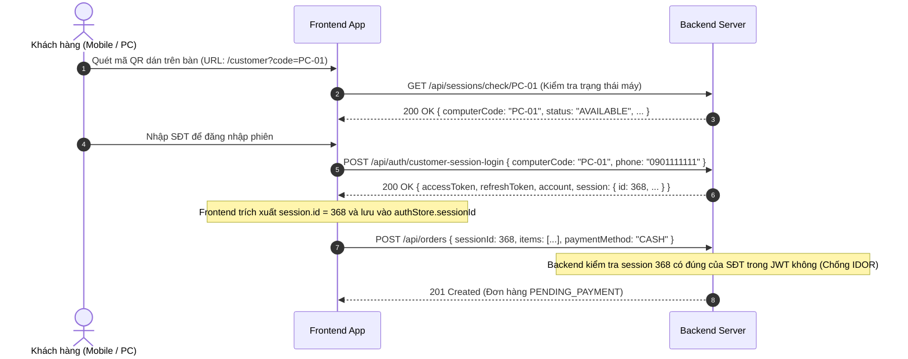

# 📜 CyberNet — Hợp Đồng Giao Tiếp API (API Contract)

> **Mục tiêu:** Cung cấp tài liệu kỹ thuật chuẩn xác, đầy đủ cho đội ngũ Frontend (Web PC & Mobile QR) tích hợp với Backend Spring Boot.  
> **Nguyên tắc:** Toàn bộ URL, method, payload request/response và mã lỗi đều dựa trên mã nguồn thực tế và kết quả kiểm thử thực tế 100%.  
> **Thời điểm cập nhật:** 21/10/2026.  
> **Độ bao phủ:** Toàn bộ các API phục vụ Phase 1 (Customer UI), Phase 2 (Staff Dashboard), Phase 3 (Admin Panel).  
> **Quy ước:** Những điểm giả định chưa có dữ liệu thực nghiệm tuyệt đối được đánh dấu rõ bằng tag `[CẦN XÁC NHẬN]`.

---

## 1. Quy Ước Nền Tảng (Core Architecture Conventions)

### 1.1 Cơ chế Xác thực & Quản lý Token (Authentication & Token Lifecycle)
- **Cơ chế:** JWT Bearer Token truyền trong header HTTP: `Authorization: Bearer <accessToken>`.
- **Thời gian sống:**
  - **Access Token:** **30 phút** (`1800000 ms`). Chứa claims: `sub` (số điện thoại), `role` (`CUSTOMER` / `STAFF` / `ADMIN`), `accountId`, `iat`, `exp`.
  - **Refresh Token:** **7 ngày** (`604800000 ms`), lưu mã UUID ngẫu nhiên trong bảng database `refresh_tokens`.
- **Cơ chế Xoay vòng (Refresh Token Rotation):**
  - Khi Access Token hết hạn (nhận lỗi `401 Unauthorized` kèm `errorCode: "TOKEN_EXPIRED"`), Frontend gọi `POST /api/auth/refresh` mang theo `refreshToken`.
  - Backend xác thực, lập tức **xóa Refresh Token cũ** trong DB và cấp một cặp `accessToken` + `refreshToken` hoàn toàn mới.
- **Tự động Thu hồi Token khi Phiên chơi Kết thúc (Security Enforcement):**
  - Khi phiên chơi đóng lại — dù do nhân viên bấm (`PATCH /api/sessions/{id}/end`) hay do server quét hết giờ (`autoEndExpiredSession`) — Backend **tự động xóa toàn bộ Refresh Token** của tài khoản khách đó (`refreshTokenRepository.deleteByAccountId()`).
  - Refresh token cũ trên điện thoại khách lập tức mất hiệu lực, chống lạm dụng sau khi rời tiệm.
- **Phân quyền vai trò (RBAC Roles):**
  - `CUSTOMER`: Khách hàng đang ngồi máy trạm hoặc quét QR trên điện thoại.
  - `STAFF`: Nhân viên thu ngân, nhân viên quầy phục vụ.
  - `ADMIN`: Quản trị viên, chủ phòng máy.

---

### 1.2 Định dạng Lỗi Chuẩn & Bảng Mã Lỗi Máy Đọc (`errorCode`)
Mọi phản hồi lỗi từ server đều tuân thủ cấu trúc JSON thống nhất [`ErrorResponse`](file:///d:/Antigravity/Java_SpringBoot/internet-cafe-management/src/main/java/com/cybernet/internet_cafe_management/dto/response/ErrorResponse.java):

```json
{
  "status": 400,
  "errorCode": "VALIDATION_ERROR",
  "message": "Dữ liệu đầu vào không hợp lệ",
  "fieldErrors": [
    {
      "field": "phone",
      "message": "Số điện thoại không được để trống"
    }
  ],
  "timestamp": "2026-10-21T01:30:00"
}
```

#### Bảng danh mục `errorCode` toàn hệ thống:

| HTTP Status | `errorCode` | Ý nghĩa & Tình huống xuất hiện |
| :---: | :--- | :--- |
| **400** | `VALIDATION_ERROR` | Lỗi validate dữ liệu DTO (`@Valid`, `@NotBlank`, `@Min`...). Có mảng `fieldErrors`. |
| **400** | `MALFORMED_REQUEST` | Request JSON sai cú pháp, sai kiểu dữ liệu param, thiếu tham số bắt buộc. |
| **401** | `UNAUTHORIZED` | Thiếu header Authorization, sai tài khoản/mật khẩu, hoặc token không hợp lệ. |
| **401** | `TOKEN_EXPIRED` | Access Token đã hết hạn (Frontend kích hoạt axios interceptor gọi refresh). |
| **401** | `REFRESH_TOKEN_INVALID` | Refresh token đã bị thu hồi, hết hạn hoặc không tồn tại trong DB. |
| **403** | `FORBIDDEN` | Sai Role truy cập tài nguyên, hoặc vi phạm bảo vệ IDOR phiên khách hàng. |
| **404** | `NOT_FOUND` | Tài nguyên không tồn tại theo ID hoặc điều kiện truy vấn chung. |
| **404** | `COMPUTER_NOT_FOUND` | Máy trạm không tồn tại theo ID hoặc mã máy (`code`). |
| **404** | `SESSION_NOT_FOUND` | Phiên chơi không tồn tại. |
| **404** | `ORDER_NOT_FOUND` | Đơn hàng không tồn tại. |
| **404** | `TIME_PURCHASE_NOT_FOUND` | Giao dịch nạp giờ không tồn tại. |
| **404** | `ACCOUNT_NOT_FOUND` | Tài khoản khách hàng/nhân viên không tồn tại. |
| **404** | `ITEM_NOT_FOUND` | Món ăn / dịch vụ không tồn tại trong thực đơn. |
| **409** | `CONFLICT` | Xung đột trạng thái tài nguyên tổng quát. |
| **409** | `COMPUTER_NOT_AVAILABLE` | Máy trạm đang bận (`IN_USE`) hoặc đang bảo trì (`MAINTENANCE`). |
| **409** | `COMPUTER_ALREADY_EXISTS` | Mã máy trạm đã tồn tại trong hệ thống. |
| **409** | `SESSION_NOT_ACTIVE` | Phiên chơi đã kết thúc (`ENDED`), không thể thao tác thêm. |
| **409** | `SESSION_INSUFFICIENT_TIME` | Tài khoản không đủ số phút chơi để mở máy. |
| **409** | `SESSION_ACCOUNT_IN_USE` | Tài khoản này đang có một phiên chơi khác đang hoạt động. |
| **409** | `ORDER_INVALID_STATUS` | Đơn hàng không ở trạng thái hợp lệ để duyệt/hủy (đã CONFIRMED hoặc CANCELLED). |
| **409** | `ORDER_OUT_OF_STOCK` | Món ăn/nước uống đã hết hàng (`available = false`). |
| **409** | `TIME_PURCHASE_INVALID_STATUS` | Giao dịch nạp giờ đã được xử lý trước đó. |
| **409** | `ACCOUNT_PHONE_EXISTS` | Số điện thoại đã được đăng ký cho tài khoản khác. |
| **429** | `RATE_LIMITED` | Vượt quá tần suất gửi request cho phép. Header trả kèm `Retry-After: 60`. |
| **500** | `INTERNAL_ERROR` | Lỗi máy chủ nội bộ. Chi tiết kỹ thuật ghi log server, client nhận message an toàn. |

---

### 1.3 Cơ chế Rate Limiting (HTTP 429 Too Many Requests)
- **Định danh Khóa (Rate Limit Key):**
  - Request đã xác thực (có Bearer JWT): Khóa theo số điện thoại: `user:<phone>`.
  - Request chưa xác thực (public/login): Khóa theo IP: `ip:<clientIp>` (hỗ trợ đọc header `X-Forwarded-For`).
- **Hạn mức phân bổ:**
  - `authLimit`: **100 requests/phút** (chống brute-force login).
  - `orderLimit`: **200 requests/phút** (đặt món & thanh toán).
  - `generalLimit`: **1000 requests/phút** (polling & tra cứu chung).
- **Phản hồi khi bị chặn:**
  - Header: `Retry-After: 60` (số giây Frontend cần chờ trước khi thử lại).
  - Body:
    ```json
    {
      "status": 429,
      "errorCode": "RATE_LIMITED",
      "message": "Bạn đã gửi quá nhiều yêu cầu. Vui lòng thử lại sau 60 giây.",
      "fieldErrors": null,
      "timestamp": "2026-10-21T01:30:00"
    }
    ```

---

### 1.4 Quy chuẩn Ngày Giờ và Tiền Tệ
- **Ngày giờ (Timestamp):** Chuỗi chuẩn ISO-8601 không lệch: `YYYY-MM-DDTHH:mm:ss`, ví dụ `2026-10-21T00:32:07`.
  - *Múi giờ vận hành:* `Asia/Ho_Chi_Minh` (GMT+7).
  - *Khuyến nghị Frontend:* Cấu hình dayjs toàn cục: `dayjs.tz.setDefault("Asia/Ho_Chi_Minh")`.
  - *Tham số query lọc ngày:* Định dạng ISO Date: `fromDate=YYYY-MM-DD&toDate=YYYY-MM-DD`.
- **Tiền tệ (Currency):** Biểu diễn dạng số `BigDecimal` với đơn vị Việt Nam Đồng (VNĐ), ví dụ `25000.00`.
  - *Frontend format:* Format hiển thị bằng hàm: `new Intl.NumberFormat('vi-VN', { style: 'currency', currency: 'VND' }).format(val)`.
- **Phân trang (Pagination):** Chuẩn Spring Data bọc trong `PageResponse<T>`:
  - Query params: `page` (0-indexed), `size` (mặc định 10 hoặc 20), `sort` (ví dụ `createdAt,desc`).
  - Response bọc ngoài gồm: `content`, `pageNumber`, `pageSize`, `totalElements`, `totalPages`, `last`.

---

### 1.5 Cách Frontend Lấy và Quản Lý `sessionId` của Khách Hàng

Quy trình chuẩn End-to-End để Frontend nhận diện và lưu trữ `sessionId`:



1. **Lấy từ Auth Response:** Ngay sau khi gọi `POST /api/auth/customer-session-login`, response trả về trường `session.id`. Frontend lưu vào Zustand Store: `authStore.getState().setSessionId(res.session.id)`.
2. **Khôi phục khi F5 (Reload):** Nếu người dùng reload trang, Frontend gọi `GET /api/sessions/active/computer/{code}` mang theo JWT hiện tại để lấy lại `SessionResponse` và khôi phục `sessionId`.
3. **Sử dụng khi Gọi món:** Mọi request tạo đơn `POST /api/orders` và xem lịch sử đơn `GET /api/orders/session/{sessionId}` đều dùng trực tiếp giá trị `sessionId` này.

---

## 2. Chi Tiết Từng Endpoint (Detailed Endpoint Specifications)

---

### 🎯 Phân Hệ 1: Xác Thực & Token (`/api/auth`)

#### 1.1. Đăng nhập Nhân viên / Admin
- **Sử dụng tại:** `MS-2.2` (Staff Login), `MS-3.1` (Admin Login).
- **Quyền hạn:** `Public (permitAll)`
- **Request:**
  - Method: `POST`
  - URL: `/api/auth/login`
  - Headers: `Content-Type: application/json`
  - Body:
    ```json
    {
      "phone": "0902222222",
      "password": "password123"
    }
    ```
- **Response Ví dụ Thực Tế (200 OK):**
  ```json
  {
    "accessToken": "eyJhbGciOiJIUzI1NiIsInR5cCI6IkpXVCJ9.eyJzdWIiOiIwOTAyMjIyMjIyIiwicm9sZSI6IlNUQUZGIiwiYWNjb3VudElkIjoyLCJleHAiOjE3Mjk0NDg0MDB9...",
    "refreshToken": "d80b5c16-e52d-4530-9b37-f4e1564fcf23",
    "tokenType": "Bearer",
    "account": {
      "id": 2,
      "phone": "0902222222",
      "fullName": "Lê Thu Ngân",
      "role": "STAFF",
      "balanceMinutes": 0,
      "createdAt": "2026-10-20T10:00:00"
    }
  }
  ```
- **Mã lỗi có thể gặp:**
  - `400 VALIDATION_ERROR`: Sai định dạng SĐT hoặc thiếu mật khẩu.
  - `401 UNAUTHORIZED`: Sai tài khoản hoặc mật khẩu.
  - `429 RATE_LIMITED`: Gửi quá 100 lần đăng nhập trong 1 phút.

---

#### 1.2. Khách hàng Quét QR Đăng nhập Phiên
- **Sử dụng tại:** `MS-1.2` (Auth Module), `MS-1.3` (Customer Login Page).
- **Quyền hạn:** `Public (permitAll)`
- **Request:**
  - Method: `POST`
  - URL: `/api/auth/customer-session-login`
  - Headers: `Content-Type: application/json`
  - Body:
    ```json
    {
      "computerCode": "PC-01",
      "phone": "0901111111"
    }
    ```
- **Response Ví dụ Thực Tế (200 OK):**
  ```json
  {
    "accessToken": "eyJhbGciOiJIUzI1NiIsInR5cCI6IkpXVCJ9...",
    "refreshToken": "8b5d3c41-864a-4e8c-8f19-b695be2463e2",
    "tokenType": "Bearer",
    "account": {
      "id": 6,
      "phone": "0901111111",
      "fullName": "Trần Gamer",
      "role": "CUSTOMER",
      "balanceMinutes": 120,
      "createdAt": "2026-10-20T12:00:00"
    },
    "session": {
      "id": 368,
      "computerId": 1,
      "computerCode": "PC-01",
      "computerZone": "STANDARD",
      "pricePerHour": 10000.00,
      "startedAt": "2026-10-21T00:32:07",
      "expiresAt": "2026-10-21T02:32:07",
      "status": "ACTIVE",
      "remainingMinutesUntilExpiry": 95
    }
  }
  ```
- **Mã lỗi có thể gặp:**
  - `400 VALIDATION_ERROR`: Thiếu `computerCode` hoặc `phone`.
  - `404 COMPUTER_NOT_FOUND`: Mã máy trạm không tồn tại.
  - `404 ACCOUNT_NOT_FOUND`: Số điện thoại chưa có tài khoản trong hệ thống.
  - `409 SESSION_NOT_ACTIVE`: Máy trạm hiện chưa có phiên chơi nào đang chạy.
  - `403 FORBIDDEN`: Khách nhập SĐT khác với SĐT của người đang ngồi phiên máy này.

---

#### 1.3. Cấp lại Access Token Mới (Token Rotation)
- **Sử dụng tại:** `MS-1.2` (Axios Response Interceptor).
- **Quyền hạn:** `Public (permitAll)`
- **Request:**
  - Method: `POST`
  - URL: `/api/auth/refresh`
  - Body:
    ```json
    {
      "refreshToken": "8b5d3c41-864a-4e8c-8f19-b695be2463e2"
    }
    ```
- **Response Ví dụ Thực Tế (200 OK):**
  ```json
  {
    "accessToken": "eyJhbGciOiJIUzI1NiIsIn...",
    "refreshToken": "9a1c2d3e-4567-890a-bcde-f1234567890a",
    "tokenType": "Bearer",
    "account": {
      "id": 6,
      "phone": "0901111111",
      "role": "CUSTOMER"
    }
  }
  ```
- **Mã lỗi có thể gặp:**
  - `400 REFRESH_TOKEN_INVALID`: Refresh token đã hết hạn, sai hoặc đã bị thu hồi do phiên kết thúc.

---

#### 1.4. Đăng xuất (Huỷ Refresh Token)
- **Sử dụng tại:** `MS-1.2`, `MS-1.4`, `MS-2.1`.
- **Quyền hạn:** `Public / Authenticated`
- **Request:**
  - Method: `POST`
  - URL: `/api/auth/logout`
  - Body:
    ```json
    {
      "refreshToken": "9a1c2d3e-4567-890a-bcde-f1234567890a"
    }
    ```
- **Response Ví dụ Thực Tế:** `HTTP 204 No Content`
- **Mã lỗi có thể gặp:** Không trả về lỗi (Idempotent 204).

---

### 🎯 Phân Hệ 2: Quản Lý Phiên Chơi Máy Trạm (`/api/sessions`)

#### 2.1. Kiểm tra Tình Trạng Máy Công Khai (Public QR Check)
- **Sử dụng tại:** `MS-1.3` (Customer Login Page), `MS-1.4` (Check Máy).
- **Quyền hạn:** `Public (permitAll)`
- **Request:**
  - Method: `GET`
  - URL: `/api/sessions/check/{computerCode}` (ví dụ `/api/sessions/check/PC-01`)
- **Response Ví dụ Thực Tế (200 OK):**
  ```json
  {
    "computerCode": "PC-01",
    "zone": "STANDARD",
    "pricePerHour": 10000.00,
    "status": "AVAILABLE",
    "hasActiveSession": false
  }
  ```
- **Mã lỗi có thể gặp:**
  - `404 COMPUTER_NOT_FOUND`: Mã máy trạm không tồn tại.

---

#### 2.2. Khách Tự Đăng Nhập Mở Máy Tại Máy Trạm (Client App)
- **Sử dụng tại:** Máy trạm desktop client.
- **Quyền hạn:** `Public (permitAll)`
- **Request:**
  - Method: `POST`
  - URL: `/api/sessions/login`
  - Body:
    ```json
    {
      "computerCode": "PC-01",
      "phone": "0901111111",
      "password": "password123"
    }
    ```
- **Response Ví dụ Thực Tế (201 Created):**
  ```json
  {
    "id": 368,
    "computerCode": "PC-01",
    "customerName": "Trần Gamer",
    "customerPhone": "0901111111",
    "startedAt": "2026-10-21T00:32:07",
    "expiresAt": "2026-10-21T03:32:07",
    "status": "ACTIVE",
    "playedMinutes": 0,
    "remainingMinutesUntilExpiry": 180,
    "pricePerHour": 10000.00
  }
  ```
- **Mã lỗi có thể gặp:**
  - `401 UNAUTHORIZED`: Sai mật khẩu tài khoản.
  - `409 COMPUTER_NOT_AVAILABLE`: Máy đang có người chơi hoặc đang bảo trì.
  - `409 SESSION_INSUFFICIENT_TIME`: Số dư tài khoản không đủ để mở máy.
  - `409 SESSION_ACCOUNT_IN_USE`: Tài khoản này đang chơi tại một máy khác.

---

#### 2.3. Nhân Viên Mở Phiên Chơi Tại Quầy (Start Session)
- **Sử dụng tại:** `MS-2.5` (Start Session Workflow).
- **Quyền hạn:** `STAFF`, `ADMIN`
- **Request:**
  - Method: `POST`
  - URL: `/api/sessions/start`
  - Headers: `Authorization: Bearer <staffToken>`
  - Body:
    ```json
    {
      "computerId": 2,
      "accountId": 6
    }
    ```
  - *(Lưu ý: Đã chốt Phương án A, không cần gửi trường `minutes`, server tự dùng toàn bộ số dư khả dụng).*
- **Response Ví dụ Thực Tế (201 Created):**
  ```json
  {
    "id": 369,
    "computerId": 2,
    "computerCode": "PC-02",
    "customerName": "Trần Gamer",
    "customerPhone": "0901111111",
    "startedAt": "2026-10-21T01:10:00",
    "expiresAt": "2026-10-21T03:10:00",
    "status": "ACTIVE",
    "playedMinutes": 0,
    "remainingMinutesUntilExpiry": 120,
    "pricePerHour": 10000.00
  }
  ```
- **Mã lỗi có thể gặp:**
  - `400 VALIDATION_ERROR`: Thiếu `computerId` hoặc `accountId`.
  - `404 COMPUTER_NOT_FOUND`: Máy không tồn tại.
  - `404 ACCOUNT_NOT_FOUND`: Khách không tồn tại.
  - `409 COMPUTER_NOT_AVAILABLE`: Máy PC-02 đang bận.
  - `409 SESSION_INSUFFICIENT_TIME`: Khách hết số phút trong tài khoản.

---

#### 2.4. Tra Cứu Phiên Đang Chạy Theo Mã Máy (Active Session)
- **Sử dụng tại:** `MS-1.4` (Customer Dashboard), `MS-2.4` (Computer Detail Drawer).
- **Quyền hạn:** `CUSTOMER`, `STAFF`, `ADMIN`
- **Request:**
  - Method: `GET`
  - URL: `/api/sessions/active/computer/{computerCode}` (ví dụ `/api/sessions/active/computer/PC-01`)
- **Response Ví dụ Thực Tế (200 OK):**
  ```json
  {
    "id": 368,
    "computerId": 1,
    "computerCode": "PC-01",
    "computerZone": "STANDARD",
    "customerName": "Trần Gamer",
    "customerPhone": "0901111111",
    "startedAt": "2026-10-21T00:32:07",
    "expiresAt": "2026-10-21T02:32:07",
    "status": "ACTIVE",
    "playedMinutes": 25,
    "remainingMinutesUntilExpiry": 95,
    "pricePerHour": 10000.00
  }
  ```
- **Mã lỗi có thể gặp:**
  - `404 NOT_FOUND`: Máy hiện không có phiên nào đang hoạt động (`SESSION_NOT_ACTIVE`).

---

#### 2.5. Kết Thúc Phiên Chơi (End Session)
- **Sử dụng tại:** `MS-2.4`, `MS-2.6` (End Session).
- **Quyền hạn:** `STAFF`, `ADMIN`
- **Request:**
  - Method: `PATCH`
  - URL: `/api/sessions/{id}/end` (ví dụ `/api/sessions/368/end`)
- **Response Ví dụ Thực Tế (200 OK):**
  ```json
  {
    "id": 368,
    "computerCode": "PC-01",
    "customerName": "Trần Gamer",
    "status": "ENDED",
    "playedMinutes": 25,
    "remainingMinutesUntilExpiry": 0
  }
  ```
  *(Hiệu ứng phụ: Máy trả về `AVAILABLE`, hoàn lại số phút chưa dùng vào tài khoản khách, xóa toàn bộ refresh token).*
- **Mã lỗi có thể gặp:**
  - `404 SESSION_NOT_FOUND`: Phiên không tồn tại.
  - `409 SESSION_NOT_ACTIVE`: Phiên đã kết thúc từ trước.

---

#### 2.6. Chuyển Máy Trạm (Transfer Computer)
- **Sử dụng tại:** `MS-2.6` (Transfer Session).
- **Quyền hạn:** `STAFF`, `ADMIN`
- **Request:**
  - Method: `PATCH`
  - URL: `/api/sessions/{id}/transfer`
  - Body:
    ```json
    {
      "newComputerId": 2,
      "markOldAsMaintenance": false
    }
    ```
- **Response Ví dụ Thực Tế (200 OK):**
  ```json
  {
    "id": 368,
    "computerId": 2,
    "computerCode": "PC-02",
    "status": "ACTIVE",
    "remainingMinutesUntilExpiry": 90
  }
  ```
- **Mã lỗi có thể gặp:**
  - `400 VALIDATION_ERROR`: Thiếu `newComputerId`.
  - `409 COMPUTER_NOT_AVAILABLE`: Máy mới đang có khách hoặc bảo trì.
  - `409 SESSION_NOT_ACTIVE`: Phiên nguồn đã kết thúc.

---

#### 2.7. Lấy Danh Sách Phiên Chơi (Filter / Polling)
- **Sử dụng tại:** `MS-2.3` (Floor Map join client), `MS-3.2` (Dashboard Stats).
- **Quyền hạn:** `STAFF`, `ADMIN`
- **Request:**
  - Method: `GET`
  - URL: `/api/sessions?status=ACTIVE&page=0&size=50`
- **Response Ví dụ Thực Tế (200 OK):**
  ```json
  {
    "content": [
      {
        "id": 368,
        "computerId": 1,
        "computerCode": "PC-01",
        "customerName": "Trần Gamer",
        "customerPhone": "0901111111",
        "startedAt": "2026-10-21T00:32:07",
        "expiresAt": "2026-10-21T02:32:07",
        "status": "ACTIVE",
        "remainingMinutesUntilExpiry": 95
      }
    ],
    "pageNumber": 0,
    "pageSize": 50,
    "totalElements": 1,
    "totalPages": 1,
    "last": true
  }
  ```

---

#### 2.8. Lịch Sử Phiên Chơi Của Một Máy Trạm Cụ Thể
- **Sử dụng tại:** `MS-2.4` (Computer Detail Drawer - Lịch sử máy).
- **Quyền hạn:** `STAFF`, `ADMIN`
- **Request:**
  - Method: `GET`
  - URL: `/api/sessions/computer/{computerId}?page=0&size=5` (ví dụ `/api/sessions/computer/1`)
- **Response Ví dụ Thực Tế (200 OK):**
  ```json
  {
    "content": [
      {
        "id": 368,
        "computerId": 1,
        "computerCode": "PC-01",
        "customerName": "Trần Gamer",
        "startedAt": "2026-10-21T00:32:07",
        "status": "ACTIVE"
      }
    ],
    "pageNumber": 0,
    "pageSize": 5,
    "totalElements": 1,
    "totalPages": 1,
    "last": true
  }
  ```
- **Mã lỗi có thể gặp:**
  - `404 COMPUTER_NOT_FOUND`: Máy không tồn tại.

---

### 🎯 Phân Hệ 3: Quản Lý Đơn Hàng & Gọi Món (`/api/orders`)

#### 3.1. Khách Hàng Tạo Đơn Đặt Món (Hoặc Nhân Viên Đặt Hộ)
- **Sử dụng tại:** `MS-1.6` (Cart & Order Creation).
- **Quyền hạn:** `CUSTOMER`, `STAFF`, `ADMIN`
- **Request:**
  - Method: `POST`
  - URL: `/api/orders`
  - Headers: `Authorization: Bearer <customerToken>`
  - Body:
    ```json
    {
      "sessionId": 368,
      "paymentMethod": "CASH",
      "items": [
        {
          "itemId": 1,
          "quantity": 2
        }
      ]
    }
    ```
- **Response Ví dụ Thực Tế (201 Created):**
  ```json
  {
    "id": 352,
    "sessionId": 368,
    "computerCode": "PC-01",
    "customerPhone": "0901111111",
    "customerName": "Trần Gamer",
    "totalAmount": 50000.00,
    "status": "PENDING_PAYMENT",
    "paymentMethod": "CASH",
    "createdAt": "2026-10-21T01:15:30",
    "confirmedAt": null,
    "confirmedByStaffName": null,
    "items": [
      {
        "itemId": 1,
        "itemName": "Mì tôm xào bò",
        "unitPrice": 25000.00,
        "quantity": 2,
        "subtotal": 50000.00
      }
    ]
  }
  ```
- **Mã lỗi có thể gặp:**
  - `400 VALIDATION_ERROR`: Thiếu món hoặc số lượng $\le 0$.
  - `400 MALFORMED_REQUEST`: Món ăn đã hết hàng (`available = false`), message: `"Món [Tên món] hiện đã hết hàng!"`.
  - `403 FORBIDDEN`: Vi phạm IDOR (khách cố tạo đơn cho `sessionId` của người khác).
  - `404 SESSION_NOT_FOUND`: Phiên không tồn tại.
  - `409 SESSION_NOT_ACTIVE`: Phiên chơi đã kết thúc, không thể đặt món.

---

#### 3.2. Thu Ngân Xác Nhận Thanh Toán Đơn Hàng (Confirm Order)
- **Sử dụng tại:** `MS-2.8` (Confirm Order).
- **Quyền hạn:** `STAFF`, `ADMIN`
- **Request:**
  - Method: `PATCH`
  - URL: `/api/orders/{id}/confirm` (ví dụ `/api/orders/352/confirm`)
  - Headers: `Authorization: Bearer <staffToken>`
  - *(Lưu ý bảo mật: Danh tính nhân viên tự động trích xuất từ JWT, KHÔNG truyền `staffId` qua query/body).*
- **Response Ví dụ Thực Tế (200 OK):**
  ```json
  {
    "id": 352,
    "status": "CONFIRMED",
    "totalAmount": 50000.00,
    "confirmedAt": "2026-10-21T01:18:22",
    "confirmedByStaffName": "Lê Thu Ngân"
  }
  ```
- **Mã lỗi có thể gặp:**
  - `404 ORDER_NOT_FOUND`: Đơn hàng không tồn tại.
  - `409 ORDER_INVALID_STATUS`: Đơn hàng đã được xác nhận hoặc đã hủy trước đó.

---

#### 3.3. Hủy Đơn Hàng (Cancel Order)
- **Sử dụng tại:** `MS-2.8` (Cancel Order).
- **Quyền hạn:** `CUSTOMER`, `STAFF`, `ADMIN`
- **Request:**
  - Method: `PATCH`
  - URL: `/api/orders/{id}/cancel` (ví dụ `/api/orders/352/cancel`)
- **Response Ví dụ Thực Tế (200 OK):**
  ```json
  {
    "id": 352,
    "status": "CANCELLED",
    "totalAmount": 50000.00
  }
  ```
- **Mã lỗi có thể gặp:**
  - `404 ORDER_NOT_FOUND`: Đơn hàng không tồn tại.
  - `409 ORDER_INVALID_STATUS`: Đơn đã `CONFIRMED`, không thể hủy.

---

#### 3.4. Bán Hàng Trực Tiếp Tại Quầy POS (Direct Order)
- **Sử dụng tại:** `MS-2.9` (Sell Time & Direct POS).
- **Quyền hạn:** `STAFF`, `ADMIN`
- **Request:**
  - Method: `POST`
  - URL: `/api/orders/direct`
  - Headers: `Authorization: Bearer <staffToken>`
  - Body:
    ```json
    {
      "sessionId": 368,
      "paymentMethod": "CASH",
      "items": [
        {
          "itemId": 3,
          "quantity": 1
        }
      ]
    }
    ```
- **Response Ví dụ Thực Tế (201 Created):** Trả về `OrderResponse` với `status: "CONFIRMED"` ngay lập tức, tự cộng giờ nếu có gói PLAYTIME.

---

#### 3.5. Xem Lịch Sử Đơn Theo Phiên Của Khách (IDOR Protected)
- **Sử dụng tại:** `MS-1.7` (Customer Order History).
- **Quyền hạn:** `CUSTOMER`, `STAFF`, `ADMIN`
- **Request:**
  - Method: `GET`
  - URL: `/api/orders/session/{sessionId}?page=0&size=10` (ví dụ `/api/orders/session/368`)
  - Headers: `Authorization: Bearer <customerToken>`
- **Response Ví dụ Thực Tế (200 OK):**
  ```json
  {
    "content": [
      {
        "id": 352,
        "sessionId": 368,
        "totalAmount": 50000.00,
        "status": "PENDING_PAYMENT",
        "paymentMethod": "CASH",
        "createdAt": "2026-10-21T01:15:30",
        "items": [
          {
            "itemId": 1,
            "itemName": "Mì tôm xào bò",
            "quantity": 2,
            "unitPrice": 25000.00,
            "subtotal": 50000.00
          }
        ]
      }
    ],
    "pageNumber": 0,
    "pageSize": 10,
    "totalElements": 1,
    "totalPages": 1,
    "last": true
  }
  ```
- **Mã lỗi có thể gặp:**
  - `403 FORBIDDEN`: Khách xem lịch sử phiên của tài khoản khác.
  - `404 SESSION_NOT_FOUND`: Phiên không tồn tại.

---

#### 3.6. Danh Sách Đơn Chờ Xử Lý Cho Quầy / Bếp (Order Queue)
- **Sử dụng tại:** `MS-2.7` (Order Queue Polling).
- **Quyền hạn:** `STAFF`, `ADMIN`
- **Request:**
  - Method: `GET`
  - URL: `/api/orders?status=PENDING_PAYMENT&page=0&size=20`
- **Response Ví dụ Thực Tế (200 OK):**
  ```json
  {
    "content": [
      {
        "id": 352,
        "sessionId": 368,
        "computerCode": "PC-01",
        "customerPhone": "0901111111",
        "totalAmount": 50000.00,
        "status": "PENDING_PAYMENT",
        "paymentMethod": "CASH",
        "createdAt": "2026-10-21T01:15:30"
      }
    ],
    "pageNumber": 0,
    "pageSize": 20,
    "totalElements": 1,
    "totalPages": 1,
    "last": true
  }
  ```

---

### 🎯 Phân Hệ 4: Bán Giờ Chơi Tại Quầy (`/api/time-purchases`)

#### 4.1. Tạo Phiếu Nạp Giờ
- **Sử dụng tại:** `MS-2.9` (Sell Time POS).
- **Quyền hạn:** `STAFF`, `ADMIN`
- **Request:**
  - Method: `POST`
  - URL: `/api/time-purchases`
  - Body:
    ```json
    {
      "accountId": 6,
      "minutes": 60,
      "amount": 10000.00,
      "paymentMethod": "CASH"
    }
    ```
- **Response Ví dụ Thực Tế (201 Created):**
  ```json
  {
    "id": 208,
    "accountId": 6,
    "accountPhone": "0901111111",
    "customerName": "Trần Gamer",
    "minutes": 60,
    "amount": 10000.00,
    "status": "PENDING_PAYMENT",
    "paymentMethod": "CASH",
    "createdAt": "2026-10-21T01:20:00"
  }
  ```
- **Mã lỗi có thể gặp:**
  - `400 VALIDATION_ERROR`: `minutes` hoặc `amount` $\le 0$.
  - `404 ACCOUNT_NOT_FOUND`: Khách không tồn tại.

---

#### 4.2. Thu Ngân Xác Nhận Nạp Giờ
- **Sử dụng tại:** `MS-2.9` (Confirm Nạp Giờ).
- **Quyền hạn:** `STAFF`, `ADMIN`
- **Request:**
  - Method: `PATCH`
  - URL: `/api/time-purchases/{id}/confirm` (ví dụ `/api/time-purchases/208/confirm`)
  - *(Lưu ý: Staff ID tự động lấy từ JWT).*
- **Response Ví dụ Thực Tế (200 OK):**
  ```json
  {
    "id": 208,
    "status": "CONFIRMED",
    "confirmedByStaffName": "Lê Thu Ngân",
    "confirmedAt": "2026-10-21T01:21:00"
  }
  ```
- **Mã lỗi có thể gặp:**
  - `404 TIME_PURCHASE_NOT_FOUND`: Phiếu nạp không tồn tại.
  - `409 TIME_PURCHASE_INVALID_STATUS`: Phiếu nạp đã được xác nhận trước đó.

---

### 🎯 Phân Hệ 5: Quản Lý Máy Trạm (`/api/computers`)

#### 5.1. Danh Sách & Tìm Kiếm Máy Trạm
- **Sử dụng tại:** `MS-2.3` (Floor Map), `MS-3.4` (Manage Computers).
- **Quyền hạn:** `STAFF`, `ADMIN`
- **Request:**
  - Method: `GET`
  - URL: `/api/computers?status=&zone=&keyword=&page=0&size=50`
- **Response Ví dụ Thực Tế (200 OK):**
  ```json
  {
    "content": [
      {
        "id": 1,
        "code": "PC-01",
        "name": "Máy 01",
        "pricePerHour": 10000.00,
        "ipAddress": "192.168.1.101",
        "zone": "STANDARD",
        "status": "AVAILABLE"
      }
    ],
    "pageNumber": 0,
    "pageSize": 50,
    "totalElements": 7,
    "totalPages": 1,
    "last": true
  }
  ```

---

#### 5.2. Tạo Mới Máy Trạm
- **Sử dụng tại:** `MS-3.4` (Thêm Máy).
- **Quyền hạn:** `STAFF`, `ADMIN`
- **Request:**
  - Method: `POST`
  - URL: `/api/computers`
  - Body:
    ```json
    {
      "code": "PC-VIP-03",
      "name": "Máy VIP 03",
      "pricePerHour": 15000.00,
      "ipAddress": "192.168.1.120",
      "zone": "VIP"
    }
    ```
- **Response Ví dụ Thực Tế (201 Created):** Trả về `ComputerResponse` với `status: "AVAILABLE"`.
- **Mã lỗi có thể gặp:**
  - `400 VALIDATION_ERROR`: Mã máy rỗng hoặc giá giờ $\le 0$.
  - `409 COMPUTER_ALREADY_EXISTS`: Mã máy đã tồn tại.

---

#### 5.3. Cập Nhật Thông Tin Máy Trạm & Toggle Bảo Trì
- **Sử dụng tại:** `MS-3.4` (Sửa Máy / Toggle Maintenance).
- **Quyền hạn:** `STAFF`, `ADMIN`
- **Request:**
  - Method: `PUT`
  - URL: `/api/computers/{id}` (ví dụ `/api/computers/1`)
  - Body:
    ```json
    {
      "code": "PC-01",
      "name": "Máy 01 Pro",
      "pricePerHour": 12000.00,
      "zone": "STANDARD",
      "status": "MAINTENANCE",
      "ipAddress": "192.168.1.101"
    }
    ```
- **Response Ví dụ Thực Tế (200 OK):**
  ```json
  {
    "id": 1,
    "code": "PC-01",
    "name": "Máy 01 Pro",
    "pricePerHour": 12000.00,
    "zone": "STANDARD",
    "status": "MAINTENANCE",
    "ipAddress": "192.168.1.101"
  }
  ```
- **Mã lỗi có thể gặp:**
  - `400 VALIDATION_ERROR`: Dữ liệu không hợp lệ.
  - `404 COMPUTER_NOT_FOUND`: Máy không tồn tại.
  - `409 COMPUTER_NOT_AVAILABLE`: Không thể chuyển sang `MAINTENANCE` khi máy đang có người chơi (`IN_USE`).

---

#### 5.4. Xóa Máy Trạm
- **Sử dụng tại:** `MS-3.4` (Xóa Máy).
- **Quyền hạn:** `ADMIN`
- **Request:**
  - Method: `DELETE`
  - URL: `/api/computers/{id}`
- **Response:** `HTTP 204 No Content`
- **Mã lỗi có thể gặp:**
  - `403 FORBIDDEN`: Staff không có quyền xóa.
  - `404 COMPUTER_NOT_FOUND`: Máy không tồn tại.
  - `409 CONFLICT`: Không thể xóa máy đang có phiên chơi.

---

### 🎯 Phân Hệ 6: Quản Lý Thực Đơn (`/api/items`)

#### 6.1. Duyệt Thực Đơn Công Khai
- **Sử dụng tại:** `MS-1.5` (Menu Browser), `MS-3.5` (Manage Menu).
- **Quyền hạn:** `Public (permitAll)`
- **Request:**
  - Method: `GET`
  - URL: `/api/items?page=0&size=20` (hoặc `/api/items/type/{FOOD|DRINK|PLAYTIME}`)
- **Response Ví dụ Thực Tế (200 OK):**
  ```json
  {
    "content": [
      {
        "id": 1,
        "name": "Mì tôm xào bò",
        "price": 25000.00,
        "type": "FOOD",
        "available": true
      },
      {
        "id": 2,
        "name": "Sting dâu",
        "price": 15000.00,
        "type": "DRINK",
        "available": true
      }
    ],
    "pageNumber": 0,
    "pageSize": 20,
    "totalElements": 6,
    "totalPages": 1,
    "last": true
  }
  ```

---

#### 6.2. Thêm Món / Gói Mới
- **Sử dụng tại:** `MS-3.5` (Thêm Món).
- **Quyền hạn:** `ADMIN`
- **Request:**
  - Method: `POST`
  - URL: `/api/items`
  - Body:
    ```json
    {
      "name": "Bò Húc Thái",
      "price": 20000.00,
      "type": "DRINK",
      "available": true
    }
    ```
- **Response Ví dụ Thực Tế (201 Created):** Trả về `ItemResponse`.
- **Mã lỗi có thể gặp:**
  - `400 VALIDATION_ERROR`: Tên rỗng hoặc giá âm.
  - `403 FORBIDDEN`: Không phải ADMIN.

---

#### 6.3. Cập Nhật Món & Toggle Hết Hàng
- **Sử dụng tại:** `MS-3.5` (Sửa Món / Switch Còn Hàng).
- **Quyền hạn:** `ADMIN`
- **Request:**
  - Method: `PUT`
  - URL: `/api/items/{id}` (ví dụ `/api/items/1`)
  - Body:
    ```json
    {
      "name": "Mì tôm xào bò đặc biệt",
      "price": 30000.00,
      "type": "FOOD",
      "available": false
    }
    ```
- **Response Ví dụ Thực Tế (200 OK):** Trả về `ItemResponse` với thông tin cập nhật.

---

#### 6.4. Xóa Món
- **Sử dụng tại:** `MS-3.5` (Xóa Món).
- **Quyền hạn:** `ADMIN`
- **Request:**
  - Method: `DELETE`
  - URL: `/api/items/{id}`
- **Response:** `HTTP 204 No Content`

---

### 🎯 Phân Hệ 7: Quản Lý Tài Khoản (`/api/accounts`)

#### 7.1. Danh Sách Tài Khoản Phân Trang
- **Sử dụng tại:** `MS-2.5` (Select Khách Hàng), `MS-3.6` (Manage Accounts).
- **Quyền hạn:** `STAFF`, `ADMIN`
- **Request:**
  - Method: `GET`
  - URL: `/api/accounts?role=CUSTOMER&page=0&size=50`
- **Response Ví dụ Thực Tế (200 OK):**
  ```json
  {
    "content": [
      {
        "id": 6,
        "phone": "0901111111",
        "name": "Trần Gamer",
        "role": "CUSTOMER",
        "remainingMinutes": 120,
        "createdAt": "2026-10-20T12:00:00"
      }
    ],
    "pageNumber": 0,
    "pageSize": 50,
    "totalElements": 5,
    "totalPages": 1,
    "last": true
  }
  ```

---

#### 7.2. Tạo Tài Khoản Mới
- **Sử dụng tại:** `MS-3.6` (Thêm Tài Khoản).
- **Quyền hạn:** `STAFF`, `ADMIN` (Chỉ ADMIN tạo được STAFF/ADMIN).
- **Request:**
  - Method: `POST`
  - URL: `/api/accounts`
  - Body:
    ```json
    {
      "phone": "0988888888",
      "name": "Nguyễn Văn A",
      "password": "password123",
      "role": "CUSTOMER"
    }
    ```
- **Response Ví dụ Thực Tế (201 Created):** Trả về `AccountResponse`.
- **Mã lỗi có thể gặp:**
  - `400 VALIDATION_ERROR`: SĐT sai định dạng hoặc password < 6 ký tự.
  - `409 ACCOUNT_PHONE_EXISTS`: Số điện thoại đã được đăng ký.

---

#### 7.3. Cập Nhật Thông Tin Tài Khoản & Reset Mật Khẩu
- **Sử dụng tại:** `MS-3.6` (Sửa Tài Khoản / Đặt Lại Mật Khẩu).
- **Quyền hạn:** `ADMIN`
- **Request:**
  - Method: `PUT`
  - URL: `/api/accounts/{id}` (ví dụ `/api/accounts/6`)
  - Body:
    ```json
    {
      "name": "Trần Gamer Pro",
      "password": "newpassword123",
      "role": "CUSTOMER"
    }
    ```
  - *(Nếu không đổi mật khẩu, có thể để trống trường `password`).*
- **Response Ví dụ Thực Tế (200 OK):** Trả về `AccountResponse` đã cập nhật.
- **Mã lỗi có thể gặp:**
  - `404 ACCOUNT_NOT_FOUND`: Tài khoản không tồn tại.
  - `403 FORBIDDEN`: Không phải ADMIN.

---

#### 7.4. Xóa Tài Khoản
- **Sử dụng tại:** `MS-3.6` (Xóa Tài Khoản).
- **Quyền hạn:** `ADMIN`
- **Request:**
  - Method: `DELETE`
  - URL: `/api/accounts/{id}`
- **Response:** `HTTP 204 No Content`

---

### 🎯 Phân Hệ 8: Báo Cáo & Thống Kê Tài Chính (`/api/reports` - Chỉ ADMIN)

#### 8.1. Báo Cáo Doanh Thu Tổng Quan
- **Sử dụng tại:** `MS-3.2` (Dashboard Overview Stats), `MS-3.3` (Pie Chart).
- **Quyền hạn:** `ADMIN`
- **Request:**
  - Method: `GET`
  - URL: `/api/reports/revenue/summary?fromDate=2026-10-01&toDate=2026-10-21`
- **Response Ví dụ Thực Tế (200 OK):**
  ```json
  {
    "totalRevenue": 15450000.00,
    "orderRevenue": 7250000.00,
    "timePurchaseRevenue": 8200000.00,
    "cashRevenue": 9450000.00,
    "transferRevenue": 6000000.00
  }
  ```

---

#### 8.2. Xu Hướng Doanh Thu Theo Ngày (Daily Continuous Time-Series)
- **Sử dụng tại:** `MS-3.3` (AreaChart 7 ngày), `MS-3.7` (Daily Revenue Table & BarChart).
- **Quyền hạn:** `ADMIN`
- **Request:**
  - Method: `GET`
  - URL: `/api/reports/revenue/daily?fromDate=2026-10-15&toDate=2026-10-21`
- **Response Ví dụ Thực Tế (200 OK):**
  ```json
  [
    {
      "date": "2026-10-15",
      "orderRevenue": 1050000.00,
      "timePurchaseRevenue": 1200000.00,
      "totalRevenue": 2250000.00,
      "orderCount": 42,
      "timePurchaseCount": 35
    },
    {
      "date": "2026-10-16",
      "orderRevenue": 950000.00,
      "timePurchaseRevenue": 1400000.00,
      "totalRevenue": 2350000.00,
      "orderCount": 38,
      "timePurchaseCount": 40
    }
  ]
  ```

---

#### 8.3. Top Món Bán Chạy Nhất
- **Sử dụng tại:** `MS-3.8` (Top Items BarChart & Table).
- **Quyền hạn:** `ADMIN`
- **Request:**
  - Method: `GET`
  - URL: `/api/reports/items/top-selling?limit=10&fromDate=&toDate=`
- **Response Ví dụ Thực Tế (200 OK):**
  ```json
  [
    {
      "itemId": 1,
      "itemName": "Mì tôm xào bò",
      "itemType": "FOOD",
      "totalQuantitySold": 142,
      "totalRevenue": 3550000.00
    }
  ]
  ```

---

#### 8.4. Top Khách Hàng Chi Tiêu Nhiều Nhất
- **Sử dụng tại:** `MS-3.8` (Top Customers Table).
- **Quyền hạn:** `ADMIN`
- **Request:**
  - Method: `GET`
  - URL: `/api/reports/customers/top-spenders?limit=10&fromDate=&toDate=`
- **Response Ví dụ Thực Tế (200 OK):**
  ```json
  [
    {
      "accountId": 6,
      "phone": "0901111111",
      "fullName": "Trần Gamer",
      "totalTimeSpent": 540000.00,
      "totalMinutesPurchased": 1800
    }
  ]
  ```

---

#### 8.5. Hiệu Suất Sử Dụng Máy Trạm
- **Sử dụng tại:** `MS-3.9` (Computer Usage Table & Comparison).
- **Quyền hạn:** `ADMIN`
- **Request:**
  - Method: `GET`
  - URL: `/api/reports/computers/usage?fromDate=&toDate=`
- **Response Ví dụ Thực Tế (200 OK):**
  ```json
  [
    {
      "computerId": 1,
      "computerCode": "PC-01",
      "zone": "STANDARD",
      "totalSessions": 48,
      "totalUsageMinutes": 4320
    }
  ]
  ```
  *(Lưu ý: Tỷ lệ sử dụng % và tổng số giờ được tính toán trên Frontend: `totalHours = (totalUsageMinutes / 60).toFixed(1)`, `utilizationRate = totalUsageMinutes / (days * 24 * 60) * 100`).*

---

### 🎯 Phân Hệ 9: Tiện Ích VietQR & Upload Tệp (`/api/files`)

#### 9.1. Sinh Mã VietQR Napas247 Động
- **Sử dụng tại:** `MS-1.6` (Thanh toán QR khách), `MS-2.9` (Nạp giờ QR quầy).
- **Quyền hạn:** `Public (permitAll)`
- **Request:**
  - Method: `GET`
  - URL: `/api/files/vietqr?amount=60000&content=ORDER-CYBERNET-352`
- **Response Ví dụ Thực Tế (200 OK):**
  ```json
  {
    "qrUrl": "https://img.vietqr.io/image/MBBank-0901111111-compact2.png?amount=60000&addInfo=ORDER-CYBERNET-352&accountName=TIEM%20NET%20CYBERNET",
    "amount": 60000,
    "content": "ORDER-CYBERNET-352"
  }
  ```

---

## 3. Các Điểm Đánh Dấu `[CẦN XÁC NHẬN]` Cho Đội Ngũ Triển Khai

| STT | Vấn đề | Tình trạng hiện tại | Hành động đề xuất |
| :---: | :--- | :--- | :--- |
| 1 | **Số lượng máy tối đa cho Floor Map Polling** | Test kiểm thử với 10 máy chạy tốt ở chu kỳ 10s. | `[CẦN XÁC NHẬN]` Khi triển khai quán trên 80 máy, nếu tải mạng LAN cao thì cân nhắc nâng polling lên 15s hoặc kích hoạt STOMP WebSocket topic `/topic/computers`. |
| 2 | **Thông tin tài khoản ngân hàng thụ hưởng VietQR** | Hiện đang cấu hình mẫu trong `application-dev.properties` (`MBBank`, STK `0901111111`). | `[CẦN XÁC NHẬN]` Chủ quán cần cung cấp số tài khoản và mã ngân hàng thực tế để cập nhật biến môi trường Production `vietqr.bank-code` và `vietqr.account-number`. |
| 3 | **Cơ chế âm thanh thông báo đơn mới (MS-2.11)** | Trình duyệt hiện đại chặn âm thanh tự phát (Audio Autoplay Policy) nếu chưa có tương tác người dùng. | `[CẦN XÁC NHẬN]` Cần yêu cầu nhân viên click một nút bất kỳ khi vào ca làm việc để cấp quyền phát âm thanh ting ting trên trình duyệt. |
