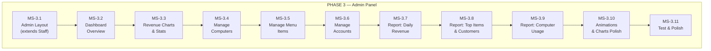
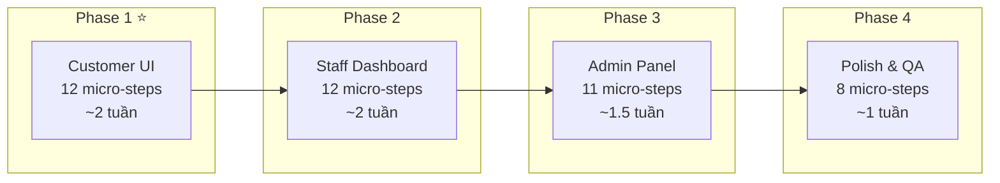

# 🎨 CyberNet Frontend — Kế hoạch thiết kế toàn diện

> **Phiên bản:** v2.0 — Có bảng màu + UI reference  
> **Trạng thái:** ⏳ Chờ phê duyệt

---

## 1. Design Foundation — Bảng màu & Ngôn ngữ thiết kế

### 1.1 Color Palette


| Token | Hex | Vai trò |
|---|---|---|
| `--midnight` | `#10232A` | **Background chính** — nền trang, sidebar, header |
| `--slate` | `#3D4D55` | **Card / Surface** — nền card, input, panel phụ |
| `--mist` | `#A79E9C` | **Text phụ / Border** — placeholder, divider, icon mờ |
| `--sand` | `#D3C3B9` | **Text chính** — body text, label, breadcrumb |
| `--gold` | `#B58863` | **Accent / Primary** — CTA button, highlight, badge, link hover, chart accent |
| `--obsidian` | `#161616` | **Deep shadow** — overlay, modal backdrop, footer |

**Màu bổ sung (semantic):**

| Token | Hex | Vai trò |
|---|---|---|
| `--success` | `#4CAF50` | Trạng thái thành công, máy Available |
| `--warning` | `#FFB74D` | Cảnh báo sắp hết giờ |
| `--danger` | `#EF5350` | Lỗi, hủy đơn, máy Maintenance |
| `--info` | `#5B8FA8` | Thông tin, máy In Use (blend tông xanh slate) |
| `--gold-light` | `#D4A574` | Gold sáng hơn cho hover state |
| `--gold-dark` | `#8B6B47` | Gold tối cho pressed state |

### 1.2 UI Reference


### 1.3 Design Language — "CyberLux / Twinkle Luxury Theme"

| Thuộc tính | Quy tắc Chuẩn Hóa Theo Ảnh Mẫu "Twinkle" |
|---|---|
| **Ambient Lighting** | `radial-gradient(ellipse at 50% 0%, rgba(181, 136, 99, 0.15) 0%, rgba(61, 77, 85, 0.08) 50%, #10232A 100%)` tạo ánh sáng hoàng hôn/đêm sao ấm áp |
| **Border Radius** | `16px - 20px` cho card/modal, `rounded-full` (dạng viên thuốc pill-shaped) cho input, nút bấm và badge |
| **Card Surface** | Gradient mềm mại: `linear-gradient(145deg, rgba(61, 77, 85, 0.85) 0%, rgba(16, 35, 42, 0.95) 100%)`, viền mỏng ánh cát `1px solid rgba(211, 195, 185, 0.12)` |
| **Shadow** | Subtle warm glow: `0 4px 24px rgba(181, 136, 99, 0.08)` cho hover state |
| **Typography** | Font: `Inter` (body) + `Space Grotesk` (chữ số to, số đếm, countdown timer, giá tiền). Chữ chính màu cát sáng `--sand` (`#D3C3B9`) |
| **Icon Style** | Lucide React — outline style, stroke-width 1.5, color `--mist` default, `--gold` on active |
| **Spacing** | Base unit `4px`, section gap `24px`, card padding `20px` |
| **Decorative** | ✨ Subtle particle/sparkle dots (CSS only) trên hero sections |
| **Transition** | Mọi interactive element: `transition: all 0.3s cubic-bezier(0.4, 0, 0.2, 1)` |

#### Bảng Quy Chuẩn Phân Cấp Thị Giác Trạng Thái (Status Visual Hierarchy):

| Trạng thái | Mã màu chủ đạo | Kiểu viền & Bề mặt | Typography & Badge | Ý nghĩa thị giác |
|---|---|---|---|---|
| **`AVAILABLE` (Máy trống)** | `#4CAF50` (Emerald) | Viền xanh sáng `border-success/60`, shadow xanh tươi | Badge xanh ngọc, chữ "SẴN SÀNG" in hoa đậm | Máy mát mẻ, đón khách được ngay |
| **`IN_USE` (Đang chơi)** | `#3D4D55` + `#B58863` | Viền xanh slate, nền sâu thẳm, viền vàng hổ phách khi chọn | Tên khách màu `#D3C3B9`, Timer font `Space Grotesk` màu `#B58863` to đậm | Phiên chơi VIP sang trọng |
| **`MAINTENANCE` (Bảo trì)** | `#EF5350` + `#A79E9C` | Nền mờ `opacity-60`, viền đỏ trầm | Icon cờ lê to, chữ "BẢO TRÌ" xám đỏ | Tách biệt tuyệt đối với máy hoạt động |
| **`PENDING` (Đơn mới/chờ)** | `#FFB74D` / `#B58863` | Viền vàng cam, shadow ấm, pulse khi chờ > 5p | Tag vàng to bản, badge `MỚI` hoặc `CHỜ XP` | Bắt mắt ngay cả khi nhìn lướt |
| **`CONFIRMED` (Đã duyệt)** | `#4CAF50` / `#5B8FA8` | Dịu màu, viền xanh dịu | Tag xanh lá hoặc xanh slate gọn gàng | Đã xử lý xong, không gây xao nhãng |

---

## 2. Tech Stack (Đã chốt)

| Concern | Giải pháp |
|---|---|
| Framework | **React 19 + Vite + TypeScript** |
| UI Components | **Ant Design 5** (ConfigProvider dark theme) |
| Layout/Utility | **Tailwind CSS 4** |
| Animation | **Framer Motion** (page transitions, mount/unmount, gestures) |
| State | **Zustand** (auth, global) + **TanStack Query v5** (server state, caching) |
| Routing | **React Router v7** (lazy loading per role) |
| HTTP | **Axios** (interceptors: JWT auto-attach, 401 auto-refresh) |
| Charts | **Recharts** (Admin dashboard, tông gold trên nền dark) |
| Icons | **Lucide React** |
| Date | **dayjs** (Ant Design built-in) |
| Fonts | **Inter** + **Space Grotesk** (Google Fonts) |

---

## 3. Folder Structure

```
frontend/
├── public/
│   └── favicon.svg
├── src/
│   ├── api/                      # Axios instance + API modules per domain
│   │   ├── axiosClient.ts
│   │   ├── authApi.ts
│   │   ├── sessionApi.ts
│   │   ├── orderApi.ts
│   │   ├── computerApi.ts
│   │   ├── itemApi.ts
│   │   ├── accountApi.ts
│   │   ├── timePurchaseApi.ts
│   │   └── reportApi.ts
│   │
│   ├── components/               # Shared components
│   │   ├── layout/               # AppShell, Sidebar, TopBar, Footer
│   │   ├── common/               # LoadingSpinner, ErrorBoundary, EmptyState, Skeleton
│   │   ├── animations/           # PageTransition, FadeIn, SlideUp, CountUp, Sparkles
│   │   └── ui/                   # StatusBadge, PriceTag, CountdownTimer, GlassCard
│   │
│   ├── features/
│   │   ├── auth/                 # Login, AuthContext, ProtectedRoute, RoleGuard
│   │   ├── customer/             # Toàn bộ Customer UI
│   │   │   ├── pages/            # CustomerLogin, Dashboard, Menu, OrderHistory
│   │   │   ├── components/       # MenuCard, CartDrawer, OrderCard, TimerRing
│   │   │   └── hooks/            # useSession, useCart, useCountdown
│   │   ├── staff/                # Toàn bộ Staff UI
│   │   │   ├── pages/            # StaffDashboard, FloorMap, POS, SessionManager
│   │   │   ├── components/       # ComputerCard, OrderQueue, SellTimeModal
│   │   │   └── hooks/            # useFloorMap, useOrderQueue
│   │   └── admin/                # Toàn bộ Admin UI
│   │       ├── pages/            # AdminDashboard, ManageComputers, ManageItems, ...
│   │       ├── components/       # RevenueChart, StatsCard, CRUDTable
│   │       └── hooks/            # useReport, useDashboard
│   │
│   ├── hooks/                    # Global hooks
│   ├── store/                    # Zustand stores
│   ├── routes/                   # Route definitions + lazy loading
│   ├── styles/                   # Global CSS, Ant theme config, Tailwind config
│   │   ├── index.css             # Tailwind directives, font imports, CSS variables
│   │   ├── antd-theme.ts         # Ant ConfigProvider theme tokens (mapped to palette)
│   │   └── animations.css        # Keyframe definitions (sparkle, pulse, glow)
│   ├── utils/                    # Helpers, formatters, constants
│   ├── App.tsx
│   └── main.tsx
│
├── index.html
├── tailwind.config.ts
├── tsconfig.json
├── vite.config.ts
└── package.json
```

---

## 4. Ant Design Theme Token Mapping

```typescript
// styles/antd-theme.ts
const cyberLuxTheme = {
  token: {
    // === Colors ===
    colorPrimary: '#B58863',           // --gold
    colorBgBase: '#10232A',            // --midnight
    colorBgContainer: '#3D4D55',       // --slate (card, input, table)
    colorBgElevated: '#3D4D55',        // --slate (modal, dropdown)
    colorBgLayout: '#10232A',          // --midnight
    colorText: '#D3C3B9',             // --sand
    colorTextSecondary: '#A79E9C',     // --mist
    colorTextPlaceholder: '#A79E9C80', // --mist 50%
    colorBorder: 'rgba(167,158,156,0.2)',  // --mist 20%
    colorBorderSecondary: 'rgba(167,158,156,0.1)',
    colorLink: '#B58863',
    colorLinkHover: '#D4A574',         // --gold-light
    colorSuccess: '#4CAF50',
    colorWarning: '#FFB74D',
    colorError: '#EF5350',
    colorInfo: '#5B8FA8',

    // === Shape ===
    borderRadius: 8,
    borderRadiusLG: 12,
    borderRadiusSM: 6,

    // === Typography ===
    fontFamily: "'Inter', -apple-system, sans-serif",
    fontSize: 14,
    fontSizeHeading1: 30,
    fontSizeHeading2: 24,

    // === Spacing ===
    padding: 16,
    paddingLG: 24,
    margin: 16,

    // === Effects ===
    boxShadow: '0 2px 12px rgba(0,0,0,0.3)',
    boxShadowSecondary: '0 4px 24px rgba(181,136,99,0.08)',
  },
  components: {
    Button: {
      primaryColor: '#10232A',         // Text trên nút gold
      borderRadiusLG: 10,
    },
    Card: {
      colorBgContainer: 'rgba(61,77,85,0.6)',
      borderRadiusLG: 12,
    },
    Table: {
      colorBgContainer: 'rgba(61,77,85,0.4)',
      headerBg: 'rgba(16,35,42,0.8)',
      rowHoverBg: 'rgba(181,136,99,0.08)',
    },
    Input: {
      colorBgContainer: 'rgba(16,35,42,0.6)',
      activeBorderColor: '#B58863',
      hoverBorderColor: '#D4A574',
    },
    Modal: {
      contentBg: '#3D4D55',
      headerBg: '#3D4D55',
    },
    Menu: {
      darkItemBg: '#10232A',
      darkItemSelectedBg: 'rgba(181,136,99,0.15)',
      darkItemSelectedColor: '#B58863',
    },
  },
};
```

---

## 5. 🎯 PHASE 1 — Customer UI (Ưu tiên cao nhất)

> **Target:** Web responsive — chạy trên cả **PC tiệm** và **điện thoại** (khách quét QR gọi món)
> **Ước lượng:** 12-15 micro-steps

```mermaid
flowchart TD
    subgraph "PHASE 1 — Customer UI"
        MS1["MS-1.1\nScaffold Project\n& Theme Setup"]
        MS2["MS-1.2\nAuth Module\n& API Layer"]
        MS3["MS-1.3\nCustomer Login\nPage"]
        MS4["MS-1.4\nSession Dashboard\n& Countdown"]
        MS5["MS-1.5\nMenu Browser\n& Filter"]
        MS6["MS-1.6\nCart & Order\nCreation"]
        MS7["MS-1.7\nOrder History\n& Detail"]
        MS8["MS-1.8\nPage Transitions\n& Animations"]
        MS9["MS-1.9\nMobile Responsive\n(QR ordering)"]
        MS10["MS-1.10\nLoading States\n& Error Handling"]
        MS11["MS-1.11\nEdge Cases\n& UX Polish"]
        MS12["MS-1.12\nIntegration Test\n& Bug Fix"]
    end
    MS1 --> MS2 --> MS3 --> MS4 --> MS5 --> MS6 --> MS7
    MS7 --> MS8 --> MS9 --> MS10 --> MS11 --> MS12
```



### MS-1.1 — Scaffold Project & Theme Setup
- [x] Init React + Vite + TypeScript project tại `/frontend`
- [x] Install dependencies: `antd`, `tailwindcss`, `framer-motion`, `axios`, `zustand`, `@tanstack/react-query`, `react-router-dom`, `lucide-react`, `dayjs`
- [x] Cấu hình `tailwind.config.ts` với custom colors (`midnight`, `slate`, `mist`, `sand`, `gold`, `obsidian`)
- [x] Tạo `antd-theme.ts` — ConfigProvider theme tokens (bảng màu CyberLux ở trên)
- [x] Tạo `index.css` — Import fonts Inter + Space Grotesk, CSS variables, Tailwind directives
- [x] Tạo `animations.css` — Keyframes: `sparkle`, `pulse-gold`, `fade-in`, `slide-up`, `glow`
- [x] Setup folder structure theo blueprint ở Section 3
- [x] Tạo `App.tsx` với ConfigProvider + QueryClientProvider + RouterProvider
- [x] Verify: chạy `npm run dev`, thấy trang trắng nền `#10232A` + text `#D3C3B9`

### MS-1.2 — Auth Module & API Layer
- [x] Tạo `api/axiosClient.ts` — Base URL từ env, request interceptor (attach Bearer token), response interceptor (401 → auto refresh token → retry)
- [x] Tạo `api/authApi.ts` — `login()` (Staff/Admin), `customerSessionLogin()` (Khách quét QR), `refreshToken()`, `logout()`
- [x] Tạo `store/authStore.ts` (Zustand) — `user`, `accessToken`, `isAuthenticated`, `login()`, `logout()`, `setToken()`
- [x] Tạo `utils/storage.ts` — `getToken()`, `setToken()`, `removeToken()` (localStorage)
- [x] Tạo `features/auth/ProtectedRoute.tsx` — Redirect về login nếu chưa auth
- [x] Tạo `features/auth/RoleGuard.tsx` — Check role, redirect nếu sai role

### MS-1.3 — Customer Login Page (QR Session Login)
- [x] **Layout:** Full-screen centered, nền gradient `midnight → obsidian`, hiệu ứng sparkle dots
- [x] **Logo/Brand:** "CYBERNET" text lớn với font Space Grotesk, màu `gold`, subtle glow animation
- [x] **Mã máy trạm:** Badge nổi bật hiển thị mã máy đọc từ URL query param `?code=PC-01`. Nếu URL không có mã máy, hiển thị cảnh báo yêu cầu quét lại QR tại bàn.
- [x] **Form Card:** GlassCard (glassmorphism), chứa:
  - Input SĐT — icon Phone, placeholder "Nhập số điện thoại của bạn", validation định dạng 10 số
  - *(Lưu ý: Không cần ô mật khẩu và không cần checkbox "Ghi nhớ đăng nhập" — Khách quét QR tại bàn chỉ cần nhập SĐT + mã máy trạm)*
  - Nút "VÀO PHIÊN CHƠI" — full-width, nền `gold`, text `midnight`, hover glow effect
- [x] **API Endpoint:** Gọi `POST /api/auth/customer-session-login` với `{ computerCode, phone }`
- [x] **Xử lý phản hồi:** Lưu `accessToken`, `refreshToken`, `sessionId` (`res.session.id`) vào Zustand `authStore` và chuyển hướng tới `/customer/dashboard`
- [x] **Error handling:** Shake animation trên form khi sai thông tin hoặc máy chưa có phiên (`409 SESSION_NOT_ACTIVE`), toast notification
- [x] **Loading:** Button chuyển loading spinner khi đang xác thực
- [x] **Responsive:** Mobile-first — form full-width padding 16px, font-size tối ưu cho màn hình cảm ứng điện thoại

### MS-1.4 — Session Dashboard (Trang chính)
- [x] **Top Bar:** Gradient `midnight` → transparent, hiện: avatar icon + tên khách, mã máy (badge gold), zone tag (VIP/Standard), nút Đăng xuất
- [x] **Countdown Timer (Hero):**
  - **Desktop:** Circular ring timer (SVG animated) — vòng tròn lớn, số HH:MM:SS font Space Grotesk cỡ 48px, màu `gold`
  - **Mobile:** Compact horizontal bar timer
  - Màu vòng tròn thay đổi: `gold` (> 30 phút) → `warning` (< 10 phút, pulse animation) → `danger` (< 5 phút, shake + flash)
  - CountUp animation khi lần đầu render số phút
- [x] **Quick Stats Row:** 3 GlassCard nhỏ ngang hàng:
  - ⏱️ Đã dùng: XX phút
  - 💰 Tiền giờ: XX.000đ/h
  - 📊 Zone: VIP / Standard
- [x] **Quick Actions:** 2 nút lớn có icon:
  - 🍔 "Gọi món" — nền `gold`, icon + text, ripple effect on click
  - 📋 "Đơn hàng" — nền `slate` viền `gold`, icon + text
- [x] **Session Info Card:** Thông tin phiên: thời gian bắt đầu, dự kiến kết thúc, số phút còn lại trong tài khoản
- [x] **API:** `GET /api/sessions/check/{code}` (công khai trạng thái máy) & `GET /api/sessions/active/computer/{code}` (chi tiết phiên đang active sau khi auth) hoặc đọc từ payload `CustomerAuthResponse.session` khi login

### MS-1.5 — Menu Browser & Filter
- [x] **Header:** "Thực đơn" + search input (debounced, tìm theo tên)
- [x] **Filter Tabs:** Horizontal scrollable tabs (Ant Segmented hoặc custom):
  - 🍽️ Tất cả · 🍔 Đồ ăn · 🥤 Đồ uống · 🎮 Gói giờ chơi
  - Active tab: underline `gold`, smooth slide animation
- [x] **Item Grid:**
  - **Desktop:** Grid 3-4 cột
  - **Mobile:** Grid 2 cột
  - Mỗi item là GlassCard:
    - Placeholder icon/image (Lucide icon theo type: Coffee, Pizza, Gamepad, Clock)
    - Tên món — font medium, color `sand`
    - Giá — font bold, color `gold`, format "XX.000₫"
    - Nút "+" to — border `gold`, hover fill `gold`
    - Hết hàng: card mờ (opacity 0.4), badge "Hết hàng" overlay
- [x] **Animation:** Item card stagger fade-in khi load, scale-up nhẹ on hover (desktop)
- [x] **API:** `GET /api/items` (public endpoint)

### MS-1.6 — Cart & Order Creation
- [x] **Floating Cart Button:** Fixed bottom-right (desktop) hoặc bottom-center bar (mobile):
  - Badge đếm số lượng món, pulse animation khi thêm
  - Tổng tiền hiện nhanh
  - Click mở Cart Drawer
- [x] **Cart Drawer (Slide-in từ phải):**
  - Danh sách món: tên, đơn giá, nút +/- quantity, nút xóa (swipe-to-delete trên mobile)
  - Tổng cộng: font lớn, color `gold`
  - Phương thức thanh toán: Radio group — 💵 Tiền mặt / 📱 QR
  - Nút "Đặt món" — full-width, gold, disabled khi giỏ trống
  - Nút "Xóa tất cả" — text button, color `danger`
- [x] **Confirmation Modal:** Sau khi bấm đặt:
  - Summary đơn hàng
  - Animation check-mark success (Lottie hoặc CSS)
  - Auto-close sau 3s, redirect về Dashboard
- [x] **Optimistic update:** TanStack Query mutation, hiện toast "Đặt món thành công!"
- [x] **API:** `POST /api/orders` với body `CreateOrderRequest`

### MS-1.7 — Order History & Detail
- [x] **Order List:** Vertical stack cards, mới nhất trên cùng
  - Mỗi card: Mã đơn `#ORD-xx`, thời gian tạo (dayjs relative: "5 phút trước"), tổng tiền
  - **Status Badge** (Ant Tag):
    - 🟡 `PENDING_PAYMENT` → "Chờ thanh toán" — tag amber, pulse nhẹ
    - 🟢 `CONFIRMED` → "Đã xác nhận" — tag green
    - 🔴 `CANCELLED` → "Đã hủy" — tag red, opacity 0.7
  - Click expand hoặc mở modal chi tiết
- [x] **Order Detail (Expand/Modal):**
  - Danh sách món: tên, SL, đơn giá, thành tiền (aligned right)
  - Divider
  - Tổng cộng, phương thức thanh toán, nhân viên xác nhận (nếu có)
- [x] **Empty State:** Illustration + text "Chưa có đơn hàng nào" + nút "Gọi món ngay"
- [x] **Pull-to-refresh:** Trên mobile, kéo xuống để refetch
- [x] **Pagination:** Load more button hoặc infinite scroll
- [x] **API:** `GET /api/orders/session/{sessionId}?page=0&size=10` (lấy danh sách đơn theo phiên của khách, bảo vệ IDOR)

### MS-1.8 — Page Transitions & Animations
- [x] **Framer Motion `AnimatePresence`** trên route changes:
  - Fade + slide-up (y: 20 → 0, opacity: 0 → 1) cho mọi page
  - Duration: 0.3s, ease: `[0.4, 0, 0.2, 1]`
- [x] **Micro-interactions:**
  - Button press: scale(0.97) → scale(1) spring
  - Card hover (desktop): translateY(-2px) + shadow tăng
  - Tab switch: underline sliding animation
  - Number changes (giá, quantity): countUp/countDown animation
  - Toast notifications: slide-in từ top-right
- [x] **Countdown timer:** Smooth circular progress ring animation (SVG `stroke-dashoffset` transition)
- [x] **Sparkle decoration:** CSS pseudo-elements, small dots `gold` random position trên Login + Dashboard hero section (giống reference)
- [x] **Loading skeleton:** Ant Skeleton với custom color matching dark theme

### MS-1.9 — Mobile Responsive (QR Ordering)

> [!IMPORTANT]
> Khách hàng có thể **quét QR trên bàn bằng điện thoại** để gọi món. URL dạng: `https://cybernet.local/customer?code=VIP-01`. Giao diện phải tối ưu cho mobile touch.

- [x] **Breakpoints:**
  - `< 640px` (sm): Mobile phone — single column, bottom nav, large touch targets
  - `640-1024px` (md): Tablet — 2 columns, sidebar collapse
  - `> 1024px` (lg): Desktop PC tiệm — full layout
- [x] **Mobile Navigation:** Bottom tab bar (fixed) thay vì top bar:
  - 🏠 Trang chủ · 🍔 Gọi món · 📋 Đơn hàng · 👤 Tài khoản
  - Active tab: icon + text color `gold`, indicator dot
- [x] **Touch Optimization:**
  - Minimum tap target: 44x44px
  - Swipe gestures: swipe-left to delete cart item
  - Pull-down to refresh on order list
  - Large +/- buttons (48px) trên menu items
- [x] **Mobile-specific layout:**
  - Login: full-screen, form chiếm 90% width, keyboard-aware (viewport resize)
  - Dashboard: countdown timer compact (horizontal bar instead of ring)
  - Menu: 2-column grid, card smaller, giá + nút + cùng dòng
  - Cart: Full-screen bottom sheet thay vì drawer
  - Order history: card list, expandable accordion
- [x] **Performance mobile:**
  - Lazy load images (nếu có)
  - Reduce animation trên low-end devices (`prefers-reduced-motion`)
  - Service Worker cho offline fallback page (PWA-lite)

### MS-1.10 — Loading States & Error Handling
- [x] **Global loading:** Thin gold progress bar trên cùng (NProgress-style) khi API call
- [x] **Skeleton screens:** Cho Dashboard, Menu, Order list — hình dạng giống content thật, color `slate` shimmer
- [x] **Error Boundary:** Catch React errors, hiện fallback UI "Đã xảy ra lỗi" + nút Thử lại
- [x] **API Error handling:**
  - 401: Auto-refresh token, nếu fail → redirect login
  - 403: Toast "Bạn không có quyền truy cập"
  - 404: Trang "Không tìm thấy" với illustration
  - 500: Toast "Lỗi máy chủ, vui lòng thử lại"
  - Network error: Toast "Mất kết nối mạng" + retry button
- [x] **Empty states:** Custom illustration + text + CTA cho mỗi danh sách trống
- [x] **Toast notification:** Ant `message` hoặc custom toast, vị trí top-center, theme dark

### MS-1.11 — Edge Cases & UX Polish
- [x] **Session expired:** Auto-detect khi phiên hết giờ → modal "Phiên đã kết thúc" → redirect login
- [x] **Concurrent order:** Nếu item hết hàng sau khi thêm vào cart → hiện warning khi submit
- [x] **Double-click prevention:** Disable button sau khi click, re-enable sau API response
- [x] **Form validation UX:** Real-time validation, hiện lỗi dưới input (red text), shake animation
- [x] **Accessibility:** Focus ring visible (outline `gold`), aria-labels trên icon buttons
- [x] **Favicon + Title:** Dynamic title: "CyberNet — [Tên màn hình]"

### 🟢 CHECKLIST TRƯỚC KHI BẮT ĐẦU PHASE 2 (ĐÃ HOÀN TẤT)
> **Yêu cầu bắt buộc:** Bổ sung thuộc tính `imageUrl` (ảnh món ăn) cho Thực đơn & Món ăn để hiển thị ảnh trực quan (mì tôm, Sting, gà rán, bò húc,...):
- [x] **Backend (Spring Boot):**
  - Cập nhật Entity `Item.java`: thêm trường `private String imageUrl;`.
  - Tạo Migration Flyway `V4__add_image_url_to_items.sql`: `ALTER TABLE items ADD COLUMN image_url VARCHAR(500);` kèm dữ liệu update ảnh cho các món mẫu hiện có.
  - Cập nhật DTOs: `ItemResponse`, `CreateItemRequest`, `UpdateItemRequest` ánh xạ trường `imageUrl`.
  - Viết Unit / Integration Test kiểm tra lưu và trả về `imageUrl` khi gọi `GET /api/items`.
- [x] **Frontend (React 19):**
  - Cập nhật `types/item.ts`: `imageUrl?: string`.
  - Cập nhật `MenuCard.tsx`: Render ảnh món ăn thật với thumbnail mượt mà, aspect ratio chuẩn, hiệu ứng bo góc CyberLux (fallback sang Lucide Icon nếu món không có ảnh).
  - Cập nhật `CartDrawer.tsx` & `OrderDetailDrawer.tsx`: Bổ sung thumbnail ảnh thu nhỏ cạnh tên món.

### MS-1.12 — Integration Test & Bug Fix (Sau khi hoàn tất checklist ảnh món)
- [ ] Test flow end-to-end: Login → Dashboard → Menu có ảnh → Add to cart → Order → View history
- [ ] Test responsive: Chrome DevTools mobile emulation (iPhone SE, iPhone 14, iPad)
- [ ] Test error scenarios: wrong password, expired token, network offline
- [ ] Fix layout bugs, animation glitches, API race conditions
- [ ] Performance audit: Lighthouse score > 90

### MS-1.12 — Integration Test & Bug Fix
- [ ] Test flow end-to-end: Login → Dashboard → Menu → Add to cart → Order → View history
- [ ] Test responsive: Chrome DevTools mobile emulation (iPhone SE, iPhone 14, iPad)
- [ ] Test error scenarios: wrong password, expired token, network offline
- [ ] Fix layout bugs, animation glitches, API race conditions
- [ ] Performance audit: Lighthouse score > 90

---

## 6. 🎯 PHASE 2 — Staff Dashboard

> **Target:** Desktop web (PC quầy nhân viên)  
> **Ước lượng:** 12 micro-steps

```mermaid
flowchart TD
    subgraph "PHASE 2 — Staff Dashboard"
        S1["MS-2.1\nStaff Layout\n& Navigation"]
        S2["MS-2.2\nStaff Login\nPage"]
        S3["MS-2.3\nFloor Map\n(Sơ đồ máy)"]
        S4["MS-2.4\nComputer Detail\nPanel"]
        S5["MS-2.5\nStart Session\nWorkflow"]
        S6["MS-2.6\nEnd/Transfer\nSession"]
        S7["MS-2.7\nOrder Queue\n(Pending Orders)"]
        S8["MS-2.8\nConfirm/Cancel\nOrder"]
        S9["MS-2.9\nSell Time\n(TimePurchase POS)"]
        S10["MS-2.10\nAnimations\n& Transitions"]
        S11["MS-2.11\nNotification\n& Alert System"]
        S12["MS-2.12\nTest & Polish"]
    end
    S1 --> S2 --> S3 --> S4 --> S5 --> S6
    S6 --> S7 --> S8 --> S9 --> S10 --> S11 --> S12
```



### MS-2.1 — Staff Layout & Navigation
- [x] **Sidebar (fixed left):** Nền `midnight`, width 240px (collapse → 64px icon-only)
  - Logo "CYBERNET" trên cùng
  - Menu items (Lucide icons + text): 🖥️ Sơ đồ máy · 🛒 Đơn hàng · 💰 Bán giờ · 📊 Phiên chơi
  - Active item: left border `gold` 3px + background `rgba(gold, 0.1)`
  - Bottom: avatar + tên nhân viên, nút Đăng xuất
- [x] **Top Bar:** Breadcrumb + search + notification bell (badge đếm order pending)
- [x] **Content Area:** Padding 24px, max-width auto, nền `midnight`

### MS-2.2 — Staff Login Page
- [x] Tương tự Customer Login nhưng:
  - Badge "NHÂN VIÊN" thay vì mã máy
  - Redirect sang Staff Dashboard sau login
  - Role check: phải là `STAFF` hoặc `ADMIN`

### MS-2.3 — Floor Map (Sơ đồ máy) ⭐
- [x] **Grid layout:** Hiển thị tất cả computers dạng card grid (4-6 cột)
- [x] **Computer Card:** Mỗi máy 1 card:
  - Mã máy (VIP-01, PC-05) — font bold
  - Zone badge: 🟣 VIP / 🔵 Standard
  - **Status indicator** (color-coded, animated):
    - 🟢 `AVAILABLE` — viền xanh, background glow nhẹ
    - 🔵 `IN_USE` — viền info blue, hiện tên khách + countdown mini
    - 🔴 `MAINTENANCE` — viền red, icon wrench, opacity giảm
  - Click → mở Computer Detail Panel (lưu máy đang chọn)
- [x] **Filter bar:** Toggle hiện theo status / zone
- [x] **Ghép dữ liệu Client-side:** Gọi song song `GET /api/computers?size=100` và `GET /api/sessions?status=ACTIVE&size=100` bằng `Promise.all`, map thông tin khách (`session.accountName`) và thời gian còn lại (`session.remainingMinutesUntilExpiry`) vào từng máy theo `computerCode`
- [x] **Auto-refresh (MVP Polling):** TanStack Query `refetchInterval: 10000` (10s polling). WebSocket STOMP backend đã sẵn sàng nhưng hoãn tích hợp sang Phase sau để giữ MVP đơn giản, ổn định
- [x] **Animation:** Card status change → brief flash + color transition

### MS-2.4 — Computer Detail Panel (Slide-in)
- [x] **Drawer từ phải** khi click vào máy:
  - Thông tin máy: Mã, Tên, Zone, IP, Giá/giờ (`GET /api/computers/{id}`)
  - Nếu `IN_USE`: Khách đang dùng, thời gian bắt đầu, còn lại (`GET /api/sessions/active/computer/{code}`), nút "Kết thúc phiên" / "Chuyển máy"
  - Nếu `AVAILABLE`: Nút "Mở phiên mới" lớn
  - Nếu `MAINTENANCE`: Nút "Đưa về sẵn sàng" (`PUT /api/computers/{id}`)
  - Lịch sử phiên gần nhất của máy (3-5 phiên): `GET /api/sessions/computer/{computerId}?page=0&size=5` (sắp xếp mới nhất)

### MS-2.5 — Start Session Workflow
- [x] **Modal "Mở phiên chơi":**
  - Select khách hàng (search by SĐT — Ant Design `Select` với `showSearch` & `filterOption` trên danh sách khách)
  - Hiện thông tin: Tên, số phút còn lại khả dụng trong tài khoản
  - **Logic thời gian (Phương án A đã chốt):** Không cần ô nhập số phút. Hệ thống tự động mở máy theo toàn bộ số dư thời gian hiện có của khách (`account.remainingMinutes`). Khi kết thúc phiên (`PATCH /api/sessions/{id}/end`), hệ thống tự động tính thời gian chơi thực tế và hoàn trả 100% số phút chưa dùng về lại tài khoản.
  - Summary: Máy XX, Khách XX, Số phút khả dụng: XX phút
  - Nút "Xác nhận mở máy" — gold, confirm dialog
- [x] **API:** `POST /api/sessions/start` với body `{ "computerId": 1, "accountId": 6 }` (dành cho nhân viên mở phiên tại quầy) hoặc `POST /api/sessions/login` (khách tự login tại máy trạm)
- [x] **Success:** Floor Map auto-update, card chuyển sang `IN_USE` với animation

### MS-2.6 — End / Transfer Session
- [x] **End Session:**
  - Confirm modal: "Kết thúc phiên cho [Tên khách] tại [Mã máy]?"
  - API: `PATCH /api/sessions/{id}/end`
  - Animation: Card chuyển về `AVAILABLE`, flash green
- [x] **Transfer Computer:**
  - Modal: chọn máy đích (chỉ hiện `AVAILABLE`), confirm
  - API: `PATCH /api/sessions/{id}/transfer`
  - Animation: Card cũ → AVAILABLE, card mới → IN_USE (cả 2 flash)

### MS-2.7 — Order Queue (Đơn hàng chờ xử lý)
- [x] **Layout:** Full-page list hoặc 2-column (Pending | Processed)
- [x] **Pending Orders:** Card list, sorted mới nhất trên:
  - Mã đơn, thời gian, mã máy, tên khách, số món, tổng tiền
  - Badge "MỚI" pulse animation cho đơn < 1 phút
  - 2 nút: ✅ Xác nhận (gold) · ❌ Hủy (red outline)
- [x] **Đã xử lý (Tab 2):** Danh sách đã confirm/cancel hôm nay
- [x] **Sound/Visual alert:** Khi có đơn mới → notification bell badge + optional sound ping
- [x] **Auto-refresh (MVP Polling):** TanStack Query `refetchInterval: 5000` (5-10s polling)
- [x] **API:** `GET /api/orders?status=PENDING_PAYMENT&page=0&size=20`

### MS-2.8 — Confirm / Cancel Order
- [x] **Confirm:** Quick-action button trên card, hoặc mở detail modal
  - API: `PATCH /api/orders/{id}/confirm` (Nhân viên xác nhận được trích xuất an toàn từ JWT; không truyền staffId qua query/body)
  - Animation: Card slide-out → vào tab "Đã xác nhận"
  - Toast: "Đơn #XX đã xác nhận"
- [x] **Cancel:** Confirm dialog trước khi hủy
  - API: `PATCH /api/orders/{id}/cancel`
  - Animation: Card fade-out red
  - Toast: "Đơn #XX đã hủy"

### MS-2.9 — Sell Time (Bán giờ chơi tại quầy)
- [x] **Modal "Bán giờ":**
  - Search khách hàng (SĐT qua Ant Design Select `showSearch`)
  - Hiện số phút hiện có
  - Chọn gói nạp hoặc nhập số phút bán: Frontend đọc bảng giá từ `GET /api/items/type/PLAYTIME` hoặc tự nhân theo đơn giá giờ để tính `amount` gửi lên Backend
  - Chọn thanh toán: Tiền mặt / QR
  - Nút "Tạo đơn bán giờ" → cần Confirm
- [x] **API:** `POST /api/time-purchases` gửi body `{ "accountId": 6, "minutes": 60, "amount": 10000.00, "paymentMethod": "CASH" }`, rồi `PATCH /api/time-purchases/{id}/confirm` (hoặc dùng `POST /api/orders/direct` bán trực tiếp tại quầy). Nhân viên thực hiện được trích xuất an toàn từ JWT.
- [x] **Success:** Hiện biên lai tóm tắt, print-friendly (optional)

### MS-2.10 — Staff Animations & Transitions
- [x] Page transitions: Framer Motion fade + slide
- [x] Floor Map: Card status transition smooth (color + border)
- [x] Order Queue: AnimatePresence — card đơn mới slide-in từ top, confirm slide-out
- [x] Sidebar: Collapse animation smooth (width transition)
- [x] Notification bell: Bounce animation khi có đơn mới

### MS-2.11 — Notification & Alert System
- [x] **Notification bell** (top bar): Badge đếm đơn pending, dropdown list recent
- [x] **Visual urgency:** Đơn chờ > 5 phút → card border flash amber
- [x] **Session expiring soon:** Nếu máy < 5 phút → Floor Map card flash warning
- [x] **Sound alert** (optional toggle): Ting khi đơn mới (Web Audio API)

### MS-2.12 — Staff Test & Polish
- [x] Test flow: Login → Floor Map → Start Session → Order confirm → Sell Time → End Session
- [x] Test concurrent: 2 tab cùng confirm 1 đơn
- [x] Layout audit: sidebar + content alignment, overflow handling
- [x] Performance: Table/Grid với 50+ computers, 100+ orders

### MS-2.12b — Staff & Customer UX/UI Polish & Twinkle Theme Refinement ⭐
- [x] **Task 1: Cập nhật CSS Foundation (Twinkle Luxury Theme):**
  - Tích hợp Ambient Lighting Gradient `radial-gradient` trên toàn bộ layout.
  - Tích hợp Card Gradient mềm mại (`#3D4D55` sang `#10232A`), bo góc lớn `rounded-2xl` và dạng viên thuốc `rounded-full` (pill shapes).
  - Tinh chỉnh Ant Design theme tokens và CSS variables khớp 100% mẫu.
- [x] **Task 2: Tái cấu trúc Menu Khách (Customer Menu Category Sections tại Tab "Tất cả"):**
  - Giữ nguyên các tab lọc đơn lẻ. Chỉ thay đổi cách hiển thị tại tab "Tất cả": render theo từng Section Category tương ứng với DB (`FOOD` ➔ 🍔 Món ăn nóng, `DRINK` ➔ 🥤 Đồ uống giải khát, `PLAYTIME` ➔ 🎮 Gói giờ chơi & Combo, `SERVICE` ➔ ⚡ Dịch vụ & Tiện ích).
  - Bổ sung header phân cách, badge đếm số lượng từng loại món và tự động ẩn danh mục rỗng.
- [x] **Task 3: Bổ sung Badge Counter thời gian thực cho Staff:**
  - Tích hợp số đếm trực quan trên Sidebar: `Đơn hàng [X]` (đơn pending), `Sơ đồ máy [Y/Z]` (tỷ lệ máy online).
  - Tích hợp đồng bộ chuông báo TopBar, đảm bảo nhân viên đi vệ sinh hoặc rời quầy quay lại biết ngay có việc cần làm.
- [x] **Task 4: Nâng cấp Phân cấp Thị giác Trạng thái (Status Contrast & Typography):**
  - Thiết kế lại `ComputerCard.tsx`: `AVAILABLE` (xanh emerald tươi sáng, chữ đậm rõ ràng), `IN_USE` (xanh slate sang trọng, số countdown to rõ font `Space Grotesk`), `MAINTENANCE` (đỏ trầm / xám tro mờ 60%).
  - Thiết kế lại `StaffOrderCard.tsx`: Tăng cường độ tương phản cho đơn chờ, đơn mới và đơn khẩn cấp.

---

## 7. 🎯 PHASE 3 — Admin Panel

> **Target:** Desktop web (PC quản lý)  
> **Ước lượng:** 11 micro-steps



### MS-3.1 — Admin Layout
- [ ] Kế thừa Staff Layout (sidebar + top bar)
- [ ] Sidebar mở rộng: thêm nhóm "Quản lý" (Máy tính, Thực đơn, Tài khoản) + "Báo cáo"
- [ ] RBAC check: chỉ `ADMIN` mới thấy menu Admin

### MS-3.2 — Dashboard Overview ⭐
- [ ] **4 Stats Cards** (top row), animated countUp on mount:
  - 💰 Doanh thu hôm nay (VNĐ)
  - 🖥️ Máy đang hoạt động / Tổng máy
  - 👤 Phiên đang active
  - 📦 Đơn hàng hôm nay
- [ ] **Quick glance:** Mini floor map (status dots) + recent orders list (5 gần nhất)
- [ ] **API:** `GET /api/reports/revenue/summary`, `GET /api/reports/revenue/daily`

### MS-3.3 — Revenue Charts
- [ ] **Biểu đồ doanh thu 7 ngày gần nhất:** Recharts AreaChart, gradient fill `gold → transparent`, axis color `mist`
- [ ] **Biểu đồ cơ cấu doanh thu:** PieChart — Order vs TimePurchase, tông `gold` + `slate`
- [ ] **Chart interactions:** Tooltip custom dark theme, hover highlight
- [ ] **Responsive:** Chart resize theo container

### MS-3.4 — Manage Computers (CRUD)
- [ ] **Ant Table** dark theme: columns Mã, Tên, Zone, Trạng thái, Giá/giờ, IP, Actions
- [ ] **Actions:** Edit (modal) / Toggle Maintenance / Delete (confirm)
- [ ] **Add new:** Modal form với validation (`POST /api/computers`)
- [ ] **Edit Modal & Inline status toggle:** Cập nhật thông tin máy hoặc đổi sang `MAINTENANCE` qua `PUT /api/computers/{id}` với `UpdateComputerRequest` (`code`, `pricePerHour`, `zone`, `status`, `ipAddress`)
- [ ] **Search + Filter:** Tìm theo mã/tên, filter theo zone/status (`GET /api/computers?status=&zone=&keyword=`)
- [ ] **Delete:** Modal confirm xóa máy (`DELETE /api/computers/{id}`)
- [ ] **API:** Full CRUD `/api/computers`

### MS-3.5 — Manage Menu Items (CRUD)
- [ ] **Ant Table:** Tên, Loại (tag color), Giá, Còn hàng (switch), Actions
- [ ] **Add/Edit Modal:** Form với select type (FOOD/DRINK/SERVICE/PLAYTIME), giá (number input VNĐ)
- [ ] **Toggle available:** Inline switch, optimistic update
- [ ] **API:** Full CRUD `/api/items`

### MS-3.6 — Manage Accounts (CRUD)
- [ ] **Ant Table:** SĐT, Tên, Role (tag), Phút còn lại, Ngày tạo, Actions
- [ ] **Add Modal:** Form tạo tài khoản mới (`POST /api/accounts`)
- [ ] **Edit Modal:** Form sửa họ tên, cập nhật vai trò hoặc đặt lại mật khẩu mới (`PUT /api/accounts/{id}`) với `UpdateAccountRequest` (`name`, `password`, `role`)
- [ ] **Delete:** Modal confirm xóa tài khoản (`DELETE /api/accounts/{id}`)
- [ ] **Phân quyền hiển thị:** Chỉ ADMIN tạo/sửa được ADMIN/STAFF
- [ ] **API:** Full CRUD `/api/accounts`

### MS-3.7 — Report: Daily Revenue
- [ ] **Date range picker** (Ant DatePicker.RangePicker), default 7 ngày gần nhất
- [ ] **Table:** Ngày, Doanh thu Order, Doanh thu Giờ chơi, Tổng
- [ ] **Chart:** Bar chart so sánh 2 nguồn doanh thu theo ngày
- [ ] **Export:** Nút "Xuất Excel" (optional, dùng SheetJS)
- [ ] **API:** `GET /api/reports/revenue/daily?fromDate=...&toDate=...`

### MS-3.8 — Report: Top Items & Top Customers
- [ ] **Top 10 món bán chạy:** Horizontal bar chart (Recharts) + table, sorted by quantity
- [ ] **Top 10 khách hàng:** Table — SĐT, Tên, Tổng chi tiêu, Số đơn
- [ ] **API:** `GET /api/reports/items/top-selling`, `GET /api/reports/customers/top-spenders`

### MS-3.9 — Report: Computer Usage
- [ ] **Table:** Mã máy, Tổng giờ sử dụng, Số phiên, Tỷ lệ sử dụng (%), Doanh thu
- [ ] **Tính toán Client-side:** API `GET /api/reports/computers/usage` trả về `totalSessions` và `totalUsageMinutes`. Frontend tự tính: `totalHours = (totalUsageMinutes / 60).toFixed(1)`, `utilizationRate = totalUsageMinutes / (days * 24 * 60) * 100`
- [ ] **Heatmap hoặc bar chart:** So sánh hiệu suất giữa các máy
- [ ] **API:** `GET /api/reports/computers/usage?fromDate=&toDate=`

### MS-3.10 — Admin Animations & Charts Polish
- [ ] Stats cards: countUp animation (0 → value), stagger delay
- [ ] Charts: draw animation on mount (Recharts `isAnimationActive`)
- [ ] Table row: hover highlight `rgba(gold, 0.05)`
- [ ] Modal: scale-in animation (Framer Motion)
- [ ] Page transitions consistent

### MS-3.11 — Admin Test & Polish
- [ ] Test CRUD flows cho Computers, Items, Accounts
- [ ] Test report date ranges, empty data states
- [ ] Test RBAC: Staff không thấy Admin menu
- [ ] Layout audit: table overflow, chart responsiveness

---

## 8. 🎯 PHASE 4 — Global Polish & Refinement

> **Ước lượng:** 8 micro-steps

| # | Task | Chi tiết |
|---|---|---|
| **MS-4.1** | **Theme fine-tuning** | Điều chỉnh colors, shadows, border-radius nhất quán. Đảm bảo contrast ratio WCAG AA |
| **MS-4.2** | **Animation audit** | Kiểm tra mọi transition/animation nhất quán, không giật, respect `prefers-reduced-motion` |
| **MS-4.3** | **Loading & Skeleton audit** | Mọi page có skeleton loading phù hợp, không flash of empty content |
| **MS-4.4** | **Error & Empty state audit** | Mọi list có empty state đẹp, mọi API error có UX xử lý rõ ràng |
| **MS-4.5** | **Responsive audit (Customer mobile)** | Test trên nhiều device: iPhone SE (375px), iPhone 14 (390px), Pixel (412px), iPad |
| **MS-4.6** | **Cross-browser test** | Chrome, Firefox, Edge, Safari (nếu có Mac). Fix vendor-prefix issues |
| **MS-4.7** | **Performance optimization** | Code splitting, lazy routes, image optimization, bundle size audit (vite-plugin-visualizer) |
| **MS-4.8** | **Final QA & Deploy prep** | Lighthouse audit (target >90), build production, test với Docker backend |

---

## 9. Tổng kết Roadmap



| Phase | Micro-steps | Ước lượng |
|---|---|---|
| **Phase 1 — Customer UI** | 12 steps | ~2 tuần |
| **Phase 2 — Staff Dashboard** | 12 steps | ~2 tuần |
| **Phase 3 — Admin Panel** | 11 steps | ~1.5 tuần |
| **Phase 4 — Polish & QA** | 8 steps | ~1 tuần |
| **Tổng** | **43 micro-steps** | **~6.5 tuần** |

> [!NOTE]
> Thời gian ước lượng dựa trên tiến độ ~2-3 micro-steps/ngày khi làm việc cùng AI. Có thể điều chỉnh tùy độ phức tạp thực tế.

---

## 10. Danh sách các điểm đã đồng bộ với Backend thực tế

Dưới đây là các điểm chuẩn hóa đã được kiểm tra và đồng bộ giữa kế hoạch frontend và backend thực tế:

| STT | Hạng mục | Trước đồng bộ | Sau đồng bộ (Khớp Backend thực tế) | Ghi chú |
|---|---|---|---|---|
| 1 | **Mở phiên chơi (Staff)** | `POST /api/sessions` | `POST /api/sessions/start` | Backend phân biệt nhân viên mở tại quầy (`/start`) và khách tự mở tại máy trạm (`/login`) |
| 2 | **Đăng nhập & Auth** | Chỉ liệt kê `customerSessionLogin` | Thêm `POST /api/auth/login` (Admin/Staff), `customer-session-login` (Khách QR), `refresh`, `logout` | Cấp đủ token và thông tin phiên |
| 3 | **Tra cứu phiên máy trạm** | `GET /api/sessions/check/{code}` kèm decode JWT | `GET /api/sessions/check/{code}` (công khai trạng thái) & `GET /api/sessions/active/computer/{code}` (chi tiết phiên sau auth) | Tránh rò rỉ dữ liệu khi chưa auth |
| 4 | **Xác nhận đơn hàng** | Nhận `staffId` qua query param | `PATCH /api/orders/{id}/confirm` (staff trích xuất từ JWT) | Chống giả mạo nhân viên (Nhóm B1) |
| 5 | **Bán hàng trực tiếp quầy** | Không rõ endpoint | `POST /api/orders/direct` | Nhân viên tạo đơn trực tiếp, tự động CONFIRMED và kích hoạt nạp giờ |
| 6 | **Xác nhận nạp giờ** | Nhận `staffId` qua query param | `PATCH /api/time-purchases/{id}/confirm` (staff trích xuất từ JWT) | Bảo mật JWT tự động (Nhóm B1) |
| 7 | **Báo cáo doanh thu tổng quan** | `GET /api/reports/summary` | `GET /api/reports/revenue/summary` | Chuẩn hóa theo `ReportController` |
| 8 | **Báo cáo doanh thu theo ngày** | `GET /api/reports/daily?from=...` | `GET /api/reports/revenue/daily?fromDate=...&toDate=...` | Tên param chuẩn ISO Date (`YYYY-MM-DD`) |
| 9 | **Top món bán chạy** | `GET /api/reports/top-items` | `GET /api/reports/items/top-selling` | Trả về danh sách top món theo số lượng & doanh thu |
| 10 | **Top khách hàng chi tiêu** | `GET /api/reports/top-customers` | `GET /api/reports/customers/top-spenders` | Thống kê khách hàng thân thiết theo số tiền nạp |
| 11 | **Hiệu suất máy trạm** | `GET /api/reports/computer-usage` | `GET /api/reports/computers/usage` | Báo cáo số lượt phục vụ và tổng số giờ hoạt động |
| 12 | **Bảo mật truy cập đơn hàng** | Khách xem đơn bằng ID session tùy ý | `GET /api/orders/session/{sessionId}` kiểm tra quyền sở hữu phiên | Chống IDOR (Nhóm B4), chỉ xem đơn của phiên mình đang dùng |
| 13 | **Cấu trúc lỗi & Rate Limit** | Lỗi thô / không có mã máy đọc | `ErrorResponse` chuẩn (`status`, `errorCode`, `message`, `fieldErrors`, `timestamp`) & 429 kèm `Retry-After: 60` | Phù hợp xử lý tập trung trên Frontend (Nhóm A1, B2) |
| 14 | **Cập nhật máy trạm & Toggle bảo trì** | Kế hoạch cũ chưa có endpoint PUT | `PUT /api/computers/{id}` nhận `UpdateComputerRequest` (`code`, `pricePerHour`, `zone`, `status`, `ipAddress`) | Đã bổ sung trên Backend kèm Integration Test PASS |
| 15 | **Cập nhật tài khoản & Đặt lại mật khẩu** | Kế hoạch cũ chưa có endpoint PUT | `PUT /api/accounts/{id}` nhận `UpdateAccountRequest` (`name`, `password`, `role`) | Đã bổ sung trên Backend kèm Integration Test PASS |
| 16 | **Lịch sử phiên theo máy trạm** | Kế hoạch cũ chưa có endpoint | `GET /api/sessions/computer/{computerId}?page=0&size=5` | Đã bổ sung trên Backend, phục vụ Drawer chi tiết máy MS-2.4 |
| 17 | **Logic mở phiên chơi quầy (Phương án A)** | Nhập số phút cần dùng hoặc "Dùng hết" | Modal mở máy không có ô nhập số phút. Server mở theo toàn bộ số dư khả dụng (`account.remainingMinutes`), tự động hoàn lại số phút dư khi kết thúc phiên | Đã phê duyệt chốt Phương án A, giữ logic Backend đơn giản và chính xác |
| 18 | **Cập nhật dữ liệu thời gian thực (MVP)** | Đề xuất dùng WebSocket STOMP ngay | Dùng TanStack Query Polling (`refetchInterval: 10000ms` cho Floor Map, `5000ms` cho Order Queue). Hoãn WebSocket sang Phase sau | Giảm độ phức tạp hạ tầng kết nối phía client cho phiên bản MVP ban đầu |
| 19 | **Đăng nhập khách quét QR (MS-1.3)** | Form có ô mật khẩu và checkbox "Ghi nhớ đăng nhập" | Bỏ ô mật khẩu và checkbox. Đăng nhập QR chỉ cần SĐT + mã máy trạm (`POST /api/auth/customer-session-login`) | Khớp thiết kế bảo mật: phiên gắn với máy vật lý, kết thúc phiên tự động thu hồi token |

